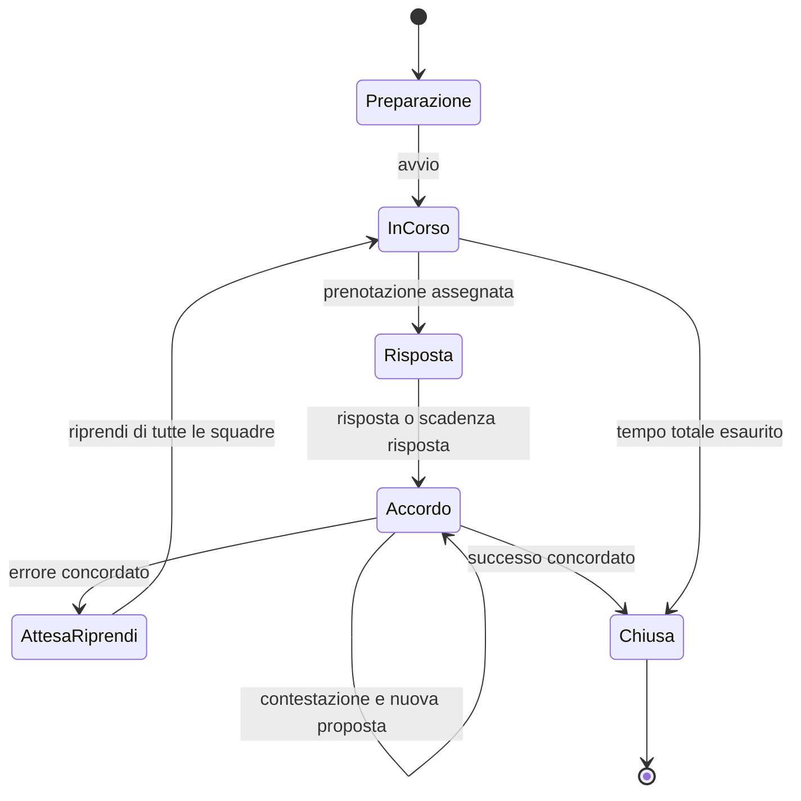
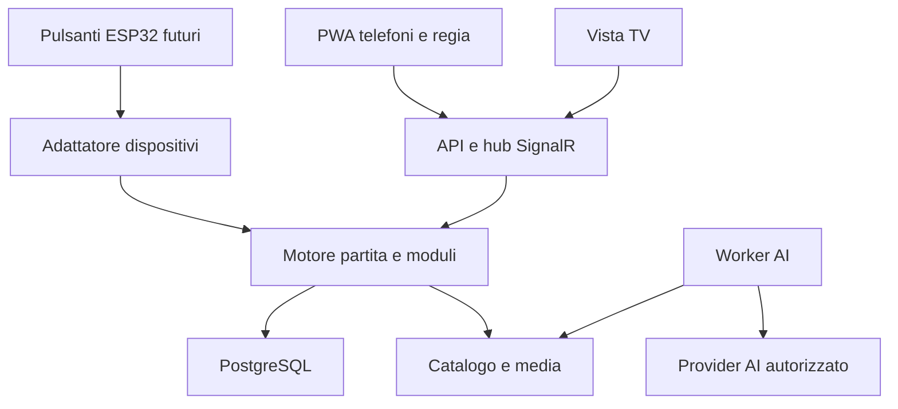

# MoscoGame — progetto del gioco e architettura della piattaforma

**Versione:** 0.2  
**Data:** 16 novembre 2026  
**Stato:** BOZZA DA VALIDARE  
**Repository:** [littlefly1969/MoscoGame](https://github.com/littlefly1969/MoscoGame)  
**Ambito di questa consegna:** progettazione funzionale e tecnica. L'implementazione software inizierà dopo la validazione dell'utente.

Le indicazioni marcate **Requisito** riprendono la richiesta. **Confermato** identifica le scelte esplicitamente precisate dall'utente nelle note; **Proposta** identifica le scelte ancora modificabili. La sezione 20 separa decisioni confermate e punti aperti. I valori indicativi e gli obiettivi prestazionali restano da validare e misurare, salvo quelli confermati, come il passo di morphing di 1 secondo e la penalità di 1 punto per una pausa respinta. L'elaborazione delle note non costituisce approvazione complessiva né autorizzazione ad avviare il software.

## 1. Visione del prodotto

**Requisito.** Creare una piattaforma multigioco di società, a squadre, utilizzabile in cloud, con giochi aggiungibili in modo modulare. **Confermato:** il gioco senza Internet è, per questa fase, soltanto una predisposizione architetturale; la sua realizzazione è rinviata. Il primo gruppo comprende giochi di parole in stile Taboo, disegno in stile Pictionary, domande e morphing. Seguiranno mimo, riconoscimento di canzoni e altre attività.

Il prodotto deve offrire una serata di gioco continua: ingresso rapido, squadre riconoscibili, alternanza dei turni, attività comuni con prenotazione, punti e penalità, carte adatte a tema e difficoltà, schermate diverse per chi conduce, chi gioca e chi guarda.

**Proposta.** Nome di lavoro MoscoGame; esperienza iniziale da salotto, con persone nella stessa stanza. L'architettura cloud permette di aggiungere partecipanti remoti, ma audio/video tra giocatori e parità competitiva su reti molto diverse richiedono una fase dedicata.

La prima versione usa una classifica semplice. Il motore dovrà poter ospitare in seguito tabellone, caselle, bonus, malus ed eventi che modificano il flusso.

### Risultato atteso della prima versione personale

- Un amministratore crea la partita e sceglie giochi, temi, difficoltà e regole.
- I partecipanti entrano con QR o codice, scelgono una squadra e ricevono una vista coerente con il proprio ruolo.
- Una TV mostra attività pubblica, timer, prenotazione e classifica.
- Ogni squadra designa un telefono ufficiale per le prenotazioni. Gli altri telefoni mostrano i contenuti consentiti al partecipante; il gioco definisce le eventuali azioni specifiche dell'esecutore, come il disegno.
- Le carte provengono da un catalogo oppure dall'AI, con controlli e riserva già pronta.
- La partita iniziale è online. Dominio e contratti mantengono la possibilità di un successivo server locale per il gioco senza Internet.
- I futuri pulsanti ESP32 si collegano allo stesso sistema di prenotazione dei telefoni.

## 2. Requisiti e confini iniziali

| ID | Requisito | Prima destinazione |
| --- | --- | --- |
| R01 | Backend C#/.NET, database PostgreSQL, frontend React | Fondazione |
| R02 | PWA installabile sui dispositivi compatibili | Fondazione e verifica browser |
| R03 | Moduli di gioco separati dal motore generale | Fondazione |
| R04 | Squadre, partecipanti, amministratore e visibilità differenziata | Prima partita completa |
| R05 | Attività di squadra e attività comuni con prenotazione | Prima partita completa |
| R06 | Guadagno/perdita punti e ricompensa maggiore alla squadra di turno | Prima partita completa |
| R07 | Catalogo di carte e generazione AI per ciascun gioco | Catalogo prima; AI dopo verifica integrazione |
| R08 | Uso personale del piano ChatGPT attraverso un flusso ufficiale idoneo | Verifica preliminare e connettore locale |
| R09 | Collegamento futuro a modelli tramite API | Contratti dalla fondazione; adattatori progressivi |
| R10 | Predisposizione del futuro gioco senza Internet su più dispositivi | Confini architetturali ora; implementazione e collaudo offline futuri |
| R11 | Visualizzazione TV Android TV/Fire TV | Vista web prima; compatibilità hardware da provare |
| R12 | Pulsanti ESP32 a batteria, LED e buzzer | Contratto predisposto; hardware in fase successiva |
| R13 | Qualità industriale: sicurezza, test, ripristino, osservabilità | Progressiva, con criteri di accettazione |
| R14 | Difficoltà, argomenti e AI dinamica | Configurazione iniziale; adattamento sperimentale |
| R15 | Matrice di visibilità configurabile e versionata per ciascun gioco | Fondazione e moduli |
| R16 | Esito concordato tra avversaria proponente e squadra interessata | Prima partita completa |
| R17 | Telefono ufficiale, tempi per gioco e penalità limitata alla successiva riapertura | Prima partita completa |
| R18 | Pausa immediata con maggioranza stretta; annullamento unanime | Prima partita completa |

**Terminologia.** Si intende **PWA**, Progressive Web App: applicazione web installabile sui browser compatibili, con risorse disponibili localmente. La PWA è la parte client; il coordinamento di una partita richiede comunque un'autorità di gioco.

**Fuori dal primo rilascio:** funzionamento multiplayer senza Internet, prenotazione da tutti i telefoni, tabellone articolato, pagamenti, marketplace di moduli, streaming audio/video, matchmaking pubblico, app native complete, generazione di immagini/video durante il conto alla rovescia e produzione definitiva dei dispositivi. Il connettore AI personale locale è una sperimentazione distinta dalla futura partita offline.

## 3. Attori, account, dispositivi e visibilità

### 3.1 Attori della prova

**Confermato.** Ogni gioco distingue la squadra che svolge la prova, i suoi componenti e una o più squadre avversarie con i rispettivi componenti. Nelle prove pubbliche tutte competono; restano distinguibili la squadra di turno e quella che ha prenotato o vinto.

L'**esecutore** è il partecipante incaricato della prova, per esempio descrittore, disegnatore o mimo. È previsto salvo le prove collettive che non richiedono un esecutore individuale. Il contratto ammette un destinatario specifico per prove uno contro uno; queste modalità sono preferibilmente escluse dalla prima selezione per privilegiare il gioco di società.

Identità permanente, squadra, ruolo nella prova e dispositivo sono distinti. Un telefono ufficiale non riceve automaticamente tutti i segreti: vede ciò che il ruolo del suo utilizzatore può conoscere.

| Attore o dispositivo | Capacità |
| --- | --- |
| Amministratore della piattaforma | Configura installazione, contenuti, connettori e utenti |
| Organizzatore della partita | Crea stanza, assegna squadre e ruoli, imposta giochi e profili |
| Squadra di turno / che svolge la prova | Partecipa come unità, tramite i propri componenti |
| Componenti della squadra | Vedono i contenuti previsti dal ruolo e dal gioco |
| Esecutore della prova | Svolge l'azione assegnata e riceve l'eventuale contenuto riservato |
| Destinatario individuale, se previsto | Riceve la prova uno contro uno; estensione non prioritaria |
| Squadre avversarie e componenti | Vedono i contenuti previsti, osservano e possono proporre l'esito |
| Squadra interessata dall'esito | Accetta o contesta la proposta: squadra esecutrice oppure vincitrice nelle prove pubbliche |
| Telefono ufficiale di squadra | Unico telefono autorizzato a prenotare per quella squadra |
| Altri telefoni | Consultazione secondo matrice; prenotazione disabilitata |
| Display TV | Riceve la vista pubblica della partita |
| Pulsante ESP32, futuro | Dispositivo associato alla squadra con capacità di prenotazione da collaudare |

**Valutazione confermata:** il gioco ordinario usa un accordo tra squadre, descritto nella sezione 5. Non richiede un arbitro individuale dedicato. I poteri amministrativi non sostituiscono il consenso richiesto dalle regole.

**Proposta sugli account:** profilo persistente di squadra, invito circoscritto alla stanza, membri con account oppure identità ospite. Gli account personali restano facoltativi nella prova personale. Un eventuale account squadra con credenziali proprie è ancora da decidere.

### 3.2 Telefono ufficiale e autorizzazioni

**Confermato:** un solo telefono ufficiale per squadra effettua le prenotazioni. La modalità in cui prenotano tutti i membri è futura e non è l'impostazione iniziale.

**Proposta operativa:** usare la stessa console per inviare proposte, accettazioni, voti di pausa/annullamento e comandi Riprendi. Le visualizzazioni personali restano disponibili sugli altri telefoni. Le azioni specifiche della prova, come tracciare un disegno, hanno un permesso distinto assegnato all'esecutore.

La sostituzione del telefono ufficiale richiede un trasferimento esplicito e registrato. Il precedente dispositivo perde il permesso prima che il nuovo possa prenotare; due connessioni o schede dello stesso browser non diventano due console ufficiali.

### 3.3 Una matrice configurabile per ciascun gioco

**Confermato:** ogni modulo dispone della propria matrice di visibilità, facilmente modificabile a seguito delle prove. Non basta una matrice globale uguale per tutti.

Le righe identificano contenuti; le colonne identificano relazioni e ruoli: esecutore, compagni, squadra di turno, squadra prenotata, avversarie e loro componenti, TV. Le condizioni possono dipendere dalla fase: preparazione, esecuzione, risposta, verifica o attività chiusa.

**Proposta tecnica:** un profilo di visibilità dichiarativo e versionato, modificabile dalla configurazione del gioco senza riscrivere le regole del motore. Ogni partita usa una versione precisa; le modifiche sperimentali entrano in vigore all'avvio di un'attività successiva, con anteprima dei destinatari. Un cambiamento non può ritirare informazioni già viste.

Le matrici della sezione 6 sono i profili iniziali da provare. In particolare, Taboo ammette che **tutti i componenti di tutte le squadre avversarie vedano le parole vietate**. Mostrare anche la parola obiettivo alle avversarie è una scelta separata, non implicita.

Il backend costruisce la vista autorizzata per destinatario e fase. URL, nomi file, miniature, log e cache seguono le stesse regole. Il profilo di visibilità non può concedere accesso a credenziali AI o dati amministrativi.

### 3.4 Organizzatore che gioca

L'organizzatore può essere un partecipante: la sua vista di gioco segue il medesimo profilo e la valutazione avviene tramite accordo tra le squadre. Non è necessario riservargli tutte le soluzioni. Chi ha accesso al database o prepara i mazzi resta un soggetto fidato e può conoscere contenuti prima della partita.

## 4. Struttura della partita e flusso generale

### 4.1 Oggetti di gioco

- **Partita:** stanza con squadre, profili, classifica e stato persistente.
- **Turno di squadra:** opportunità assegnata dalla rotazione generale.
- **Attività/prova:** evento di un modulo, riservato alla squadra corrente oppure pubblico.
- **Carta:** contenuto versionato scelto per l'attività.
- **Finestra di prenotazione:** singola apertura alle squadre ammesse, numerata all'interno dell'attività.
- **Tentativo:** prenotazione e risposta di una squadra.
- **Proposta di esito:** dichiarazione di un'avversaria, con risultato e squadra interessata.
- **Accordo:** accettazione della proposta corrente da parte della squadra interessata.
- **Consultazione:** votazione di pausa, annullamento o raccolta dei Riprendi, con regola propria.
- **Movimento punti:** variazione motivata, confermata una sola volta.

**Distinzione confermata:** saltare la prossima finestra di prenotazione nella stessa attività non significa saltare il successivo turno di squadra.

### 4.2 Flusso della partita

La rotazione e la selezione dei giochi restano proposte da validare. Una volta scelta la prova:

1. Il server prepara modulo, carta, ruoli, profilo di visibilità e tempi.
2. Ogni dispositivo riceve i contenuti consentiti; si avvia il conto alla rovescia.
3. In una prova di squadra agiscono i partecipanti designati della squadra corrente.
4. In una prova pubblica prenotano i telefoni ufficiali delle squadre ammesse.
5. Il tentativo conduce a una proposta di esito da un'avversaria e all'accettazione della squadra interessata.
6. Se l'esito è contestato, viene riformulato finché le due squadre concordano; i punti del tentativo restano da confermare.
7. Se il tentativo non conclude una prova pubblica progressiva, si raccolgono i Riprendi di tutte le squadre.
8. Alla chiusura si registrano i movimenti definitivi e si passa al successivo turno di squadra.

**Proposta:** vincere una prova pubblica non cambia automaticamente la rotazione. Annullamento e pausa seguono i protocolli distinti della sezione 5.

### 4.3 Stati della prova pubblica progressiva

Alla prenotazione si congela il tempo totale della prova e la progressione dei media; parte il tempo di risposta. Nel morphing questa regola è esplicitamente confermata. Accordo, pausa ed eventuale annullamento sono stati persistenti, non semplici finestre grafiche.

Il diagramma mostra il percorso normale. Un annullamento approvato da tutte le squadre conduce a uno stato terminale dedicato. Una richiesta di pausa sospende lo stato corrente e conserva i tempi, senza introdurre una nuova finestra di prenotazione.

### 4.4 Selezione attività e fine partita

**Proposte iniziali:**

- Selezione ponderata dei moduli, con limiti alle ripetizioni consecutive.
- Bilanciamento del numero e difficoltà delle prove di squadra/pubbliche tra le squadre.
- Sequenza e seed registrati; carte e ordine futuro restano sul server.
- Carte non ripetute nella partita; esaurimento segnalato alla regia.
- Fine dopo un numero configurabile di giri completi; varianti a tempo o punteggio successive.
- Classifica ex aequo in caso di parità, oppure spareggio pubblico opzionale.

Il numero di squadre di riferimento è almeno due. La fine dell'attività non viene mai provocata dall'esclusione cumulativa di tutte le squadre. Le attività possono comunque chiudersi per successo, scadenza del tempo totale o annullamento unanime.

## 5. Esiti concordati, prenotazioni, punti e controllo dei tempi

### 5.1 Tre regole di consenso distinte

| Operazione | Chi la propone | Consenso richiesto | Stato |
| --- | --- | --- | --- |
| Conferma dell'esito | Una squadra avversaria | Squadra proponente e squadra interessata | Confermato |
| Annullamento dell'attività | Una squadra avversaria alla squadra interessata | Tutte le squadre, inclusa quella che ha giocato | Confermato |
| Pausa richiesta da una squadra | Qualsiasi squadra | Maggioranza stretta delle squadre | Confermato |
| Ripresa di una prova pubblica progressiva | Ogni squadra invia Riprendi | Riprendi di tutte le squadre | Confermato |

Le soglie non sono intercambiabili. Una squadra temporaneamente non ammessa a prenotare continua a partecipare ai consensi richiesti.

### 5.2 Proposta e accettazione dell'esito

Una delle avversarie propone il superamento della prova o l'esito del tentativo. La squadra che ha eseguito la prova, oppure quella che ha risposto/vinto nella prova pubblica, accetta o contesta. Per confermare bastano queste due squadre; le altre non hanno un voto obbligatorio sull'esito ordinario.

In caso di contestazione non si assegnano definitivamente i punti proposti. Le due squadre discutono e viene presentata una nuova versione della proposta fino all'accordo. Una modifica invalida l'accettazione della versione precedente. Il server verifica che una squadra non proponga e accetti da sola il proprio esito.

**Proposta tecnica:** una proposta corrente per tentativo, con proponente, squadra interessata, versione, risultato, motivazione e accettazione. Il protocollo non attribuisce a una persona il potere di arbitrare unilateralmente.

Per giudicare una risposta pubblica senza compromettere i tentativi successivi, non si rivela la soluzione canonica a tutte le squadre prima della chiusura. Il modulo può fornire un riscontro sulla risposta già dichiarata; il confronto con le varianti accettate resta sul server. Un suggerimento automatico o AI non sostituisce l'accordo.

Se la valutazione necessita di rivelare la soluzione, il modulo deve collocare la rivelazione in una fase che impedisca ulteriori tentativi su quel segreto. Come gestire un disaccordo protratto è una decisione ancora aperta; non si presume un arbitro di riserva.

### 5.3 Prenotazione e tempo di risposta

**Confermato:**

- Prenota soltanto il telefono ufficiale associato alla squadra. Gli altri telefoni non possono inviare una prenotazione valida, neppure chiamando direttamente l'API.
- L'opzione con tutti i componenti abilitati è futura.
- Il sistema deve cercare la massima precisione possibile nell'individuare chi ha premuto per primo.
- Il tempo di risposta è configurabile per **tipo di gioco**, separatamente dal tempo totale della prova.
- Alla prenotazione si fermano timer totale e progressione dell'attività; parte soltanto il tempo di risposta.
- La durata totale non deve essere consumata dalla finestra di risposta nel morphing.

Il server apre una finestra identificata e assegna la prima prenotazione valida in modo atomico. Registra l'ordine osservabile con il massimo dettaglio consentito dall'infrastruttura. Il feedback di vittoria su telefono e TV segue l'assegnazione del server.

**Limite da verificare:** l'ordine fisico delle pressioni può differire dall'ordine di ricezione per la latenza. La misura iniziale usa l'ordine autorevole di ricezione; i timestamp client sono diagnostici e non decidono da soli il vincitore. Gli ESP32 saranno valutati per migliorare precisione e uniformità, senza presumere un miglioramento già misurato.

La risposta ricevuta o la scadenza della sua finestra porta alla valutazione. L'ammontare dell'eventuale penalità per errore o timeout resta parte del profilo del gioco; il sistema non trasforma automaticamente una contestazione in una nuova penalità.

### 5.4 Esclusione temporanea e Riprendi

**Confermato:** è possibile configurare che una squadra che sbaglia salti **soltanto la successiva riapertura delle prenotazioni nella stessa attività**. Dopo quella finestra torna ammessa. Non è un'esclusione per tutta l'attività né una penalità sul prossimo turno della partita.

Le finestre sono numerate. La squadra che sbaglia nella finestra k può essere esclusa dalla k+1; dalla k+2 torna disponibile se l'attività prosegue. Una sospensione o un rifiuto di pausa non incrementano il numero della finestra.

**Confermato:** non si possono escludere contemporaneamente tutte le squadre. Il motore e i profili devono preservare almeno una squadra ammessa a ogni nuova apertura. Nessuna chiusura per “tutte escluse”: se non arriva una risposta corretta, il limite è il tempo totale.

Per una prova pubblica progressiva, prima di una nuova apertura **tutte le squadre devono inviare Riprendi**, compresa quella temporaneamente non ammessa a prenotare. I consensi valgono soltanto per la specifica ripresa e vengono azzerati alla successiva richiesta. Non si applica qui la maggioranza della pausa.

### 5.5 Pausa: arresto immediato e maggioranza stretta

Una squadra preme il pulsante di pausa. Il server congela immediatamente il timer interessato al valore corrente e arresta la progressione dell'attività. Non aspetta l'esito della votazione. Se è in corso una finestra di risposta, **proposta operativa**: congelare anche quel timer, così il fermo non produce un errore per timeout.

Ogni squadra esprime un voto. Serve più della metà del totale delle squadre:

| Squadre totali | Consensi necessari |
| --- | --- |
| 2 | 2 |
| 3 | 2 |
| 4 | 3 |
| 5 | 3 |
| 6 | 4 |

**Proposta operativa:** la squadra proponente conta come un consenso; il denominatore comprende tutte le squadre della partita, non soltanto i dispositivi connessi. Si registra un solo voto per squadra.

- Se si raggiunge la maggioranza stretta, la pausa è approvata e il timer rimane fermo.
- Se la proposta viene respinta, la squadra proponente perde **1 punto**.
- Dopo il rifiuto, il timer riparte **dal valore congelato**, senza sottrarre il tempo della votazione.
- Il rifiuto conclude quella richiesta e produce al massimo un movimento di penalità, anche se il messaggio viene ripetuto.

Resta da definire quando dichiarare respinta una richiesta con voti mancanti e come autorizzare la ripresa di una pausa approvata nei giochi non progressivi. Nelle prove pubbliche progressive resta valido il Riprendi di tutte le squadre.

### 5.6 Annullamento dell'attività

**Confermato:** una squadra avversaria propone l'annullamento e devono accettare **tutte le squadre**, inclusa quella che ha svolto o vinto la prova. La maggioranza stretta non basta.

La richiesta identifica attività e motivo. Senza tutte le accettazioni non esiste un annullamento confermato; la richiesta è distinta dalla pausa e non ne eredita automaticamente né l'arresto dei timer né la penalità di 1 punto.

Un annullamento confermato chiude l'attività e compensa gli effetti di punteggio legati al suo risultato. Le carte contestate possono essere segnalate e messe in quarantena. La sorte di eventuali penalità procedurali già maturate, come una pausa respinta, va fissata nel profilo prima dello sviluppo.

### 5.7 Profilo punti da bilanciare

| Evento | Valore o effetto | Stato |
| --- | --- | --- |
| Carta Taboo indovinata | +1 alla squadra corrente per carta | Proposta |
| Uso confermato di parola vietata | -1 e cambio carta | Proposta |
| Passaggio carta Taboo | 0; limite configurabile | Proposta |
| Pictionary riuscito | +3 alla squadra corrente | Proposta |
| Pictionary scaduto | 0 | Proposta |
| Prova pubblica: corretta della squadra di turno | +3 | Proposta |
| Prova pubblica: corretta di altra squadra | +2 | Proposta |
| Risposta pubblica errata / timeout | -1; possibile salto della sola prossima finestra | Importo proposto; ambito del salto confermato |
| Pausa respinta | -1 alla squadra proponente | Confermato |
| Tempo totale esaurito senza soluzione | 0 ulteriori punti | Proposta |
| Annullamento unanime | Compensazione dei punti di risultato dell'attività | Confermato; penalità procedurali da definire |

Punteggi negativi consentiti è ancora una proposta. I valori dei diversi giochi vanno bilanciati per difficoltà, durata e numero di carte.

Il motore conserva un registro dei movimenti con motivo, squadra, attività, tentativo/procedura e autore. Le rettifiche aggiungono compensazioni collegate agli originali. Nessun accordo, rifiuto o annullamento ripetuto in rete può produrre due volte lo stesso effetto.

### 5.8 Esempio con due squadre

A è di turno. B prenota e sbaglia; A propone l'esito e B lo accetta. Se la penalità temporanea è attiva, B salta la prossima finestra. Dopo i Riprendi di entrambe, A può prenotare. Se anche A sbaglia, B propone l'esito e A lo accetta; alla riapertura seguente A salta e B è nuovamente ammessa. Se nessuna risolve, il limite resta il tempo totale della prova.

Con il profilo punti proposto, una soluzione di A vale +3, una soluzione di B +2. Dopo la chiusura il turno passa a B, secondo la rotazione generale ancora da validare.

## 6. Moduli iniziali e matrici di visibilità

Le matrici seguenti descrivono profili iniziali configurabili. “Dopo chiusura” significa soltanto quando il segreto non verrà riutilizzato per ulteriori tentativi. L'esecutore è un ruolo distinto; nelle prove pubbliche collettive può essere assente.

| Modulo | Modalità iniziale | Contenuto | Tempo totale indicativo |
| --- | --- | --- | --- |
| Parole vietate, stile Taboo | Di squadra | Parola obiettivo, 5 vietate, tema e difficoltà | 60 s, più carte |
| Disegno, stile Pictionary | Di squadra | Soggetto e criteri di accettazione | 90 s, una carta |
| Domande | Pubblica | Domanda, soluzione, varianti, spiegazione e fonti necessarie | 30 s |
| Morphing | Pubblica | Volto iniziale standard, sequenza di immagini, volto finale e soluzione | Da tarare sul numero di immagini |

**Confermato:** tempo di risposta configurabile per tipo di gioco; per il morphing il passo è **1 secondo per immagine**. I tempi totali della tabella sono proposte.

### 6.1 Parole vietate

L'esecutore descrive; i compagni indovinano. Tutti i componenti delle squadre avversarie possono vedere le parole vietate per controllare la prova. L'esito o la violazione vengono proposti da un'avversaria e accettati dalla squadra che gioca.

| Contenuto | Esecutore | Compagni che indovinano | Tutte le avversarie e i loro componenti | TV |
| --- | --- | --- | --- | --- |
| Parola obiettivo | Sì | Dopo chiusura carta | Dopo chiusura carta, profilo da provare | Dopo chiusura carta |
| Parole vietate | Sì | Dopo chiusura carta | Sì durante la prova | Dopo chiusura carta |
| Timer e punteggio | Sì | Sì | Sì | Sì |
| Proposta/esito e stato dell'accordo | Sì | Sì | Sì | Sì, senza segreti anticipati |

La visibilità delle vietate a tutte le avversarie è il caso richiesto da predisporre. La visibilità dell'obiettivo alle avversarie resta configurabile e separata. L'accordo non implica che tutti i membri abbiano il permesso di inviare comandi ufficiali.

Difficoltà modulabile per numero/forza delle vietate, astrattezza e tempo. La carta successiva arriva all'esecutore quando la precedente è chiusa. La gestione del tempo mentre si concorda ogni carta va specificata nel profilo del modulo. Il riconoscimento vocale non è necessario al primo rilascio.

### 6.2 Disegno

**Proposta:** disegno su telefono/tablet, riprodotto sulla TV, con variante su lavagna fisica. L'esecutore vede il soggetto, i compagni lo indovinano. La validazione segue il medesimo accordo tra avversaria proponente e squadra che gioca.

| Contenuto | Disegnatore | Compagni | Tutte le avversarie e i loro componenti | TV |
| --- | --- | --- | --- | --- |
| Soggetto segreto | Sì | Dopo chiusura | Dopo chiusura, profilo da provare | Dopo chiusura |
| Disegno in corso | Sì | Sì | Sì | Sì |
| Timer e stato della prova | Sì | Sì | Sì | Sì |
| Proposta/esito e accordo | Sì | Sì | Sì | Sì |

Il tratto compare subito sul dispositivo dell'esecutore e viene trasmesso con aggiornamenti raggruppati e coordinate normalizzate. Gomma, annulla e cancella; checkpoint per i rientri. Il server controlla autore e dimensione/frequenza dei messaggi. Il soggetto resta escluso dai metadati pubblici della tela.

### 6.3 Domande

Prova pubblica iniziale a risposta orale. Prenota il telefono ufficiale; una squadra diversa da quella che ha risposto propone l'esito e la squadra interessata lo accetta o contesta. Risposte scritte e scelta multipla sono estensioni del modulo.

| Contenuto | Squadra di turno | Squadra prenotata | Altre squadre e componenti | TV |
| --- | --- | --- | --- | --- |
| Domanda | Sì | Sì | Sì | Sì |
| Soluzione e varianti canoniche | Dopo chiusura | Dopo chiusura | Dopo chiusura | Dopo chiusura |
| Tempo totale / tempo di risposta | Sì | Sì | Sì | Sì |
| Risposta dichiarata, proposta e accordo | Sì | Sì | Sì | Sì |

Le colonne sono relazioni che possono sovrapporsi. Nessuna squadra ottiene la soluzione anticipata solo perché è di turno o deve proporre un esito. Il server può confrontare la risposta con varianti autorizzate e offrire un riscontro; l'AI può suggerire, senza diventare decisore finale.

### 6.4 Morphing di volti

**Meccanica confermata dall'utente, già sperimentata in un'altra prova:**

1. Si parte dal volto/maschera standard di Dalí de *La casa di carta*.
2. Una sequenza di immagini trasforma progressivamente il volto iniziale nel volto di un personaggio famoso oppure di un'altra persona.
3. Si avanza di **un'immagine ogni secondo**.
4. Quando una squadra ottiene la prenotazione, si congelano **sia il morphing sia il timer totale** al valore corrente.
5. Parte soltanto il tempo di risposta configurato per il morphing.
6. Una squadra avversaria propone l'esito e quella che ha risposto lo accetta o contesta.
7. Se la risposta non conclude l'attività, il morphing riparte solo dopo il **Riprendi di tutte le squadre**, applicando l'eventuale salto della successiva finestra a chi ha sbagliato.
8. Alla ripresa continuano tempo residuo e sequenza dal punto congelato; i secondi trascorsi per risposta e attesa non vengono recuperati accelerando le immagini.

| Contenuto | Squadra di turno | Squadra prenotata | Altre squadre e componenti | TV |
| --- | --- | --- | --- | --- |
| Immagine corrente autorizzata | Sì | Sì | Sì | Sì |
| Immagini future / volto finale non ancora raggiunto | No | No | No | No |
| Nome/soluzione del soggetto | Dopo chiusura | Dopo chiusura | Dopo chiusura | Dopo chiusura |
| Timer, prenotazione e stato Riprendi | Sì | Sì | Sì | Sì |
| Risposta dichiarata, proposta e accordo | Sì | Sì | Sì | Sì |

Il profilo di visibilità può essere modificato per le prove. La prima impostazione protegge i fotogrammi futuri: non si distribuisce al browser un archivio completo contenente già la soluzione o URL prevedibili del volto finale.

**Proposta di realizzazione:** sequenze preprodotte e manifest con ordine delle immagini, passo di 1 secondo, soluzione e varianti accettate. Il server conserva indice e frazione residua del passo, così una pausa non provoca salti o avanzamenti automatici alla riapertura. Le viste recuperano lo stesso stato autorevole.

Numero di immagini, tempo totale, scelta dei volti e formato degli asset restano da definire. Il precedente prototipo potrà essere riutilizzato quando il relativo materiale sarà disponibile nel progetto. Preparazione della sequenza e generazione AI sono attività separate dalla riproduzione della prova.

### 6.5 Moduli successivi

Mimo riutilizza esecutore, segreto e timer. Indovina la canzone riutilizza media pubblici, prenotazione e consensi, con una propria matrice e tempi. Disponibilità dei brani, diritti e futuro uso offline vanno definiti prima del rilascio.

I riferimenti a Taboo e Pictionary descrivono la meccanica. Nome, grafica e cataloghi del prodotto dovranno essere originali o utilizzabili con autorizzazione. Le sequenze di volti e i relativi media mantengono provenienza e condizioni d'uso.

## 7. Esperienza visiva e uso dei dispositivi

**Direzione proposta:** sala giochi contemporanea, sfondo scuro, accenti vivaci, carte grandi, animazioni brevi, suoni riconoscibili e forte identità delle squadre. Una famiglia grafica comune collega tutti i minigiochi.

| Superficie | Priorità |
| --- | --- |
| Telefono personale non ufficiale | Contenuti consentiti dal profilo del gioco, ruolo e stato chiari; prenotazione non disponibile |
| Telefono esecutore | Carta segreta leggibile, protezione dal mostrare accidentalmente il contenuto |
| Telefono ufficiale / console squadra | Prenotazione grande, stato di abilitazione, risposta, proposte e consensi secondo permessi |
| Regia organizzatore | Avvio, ruoli, telefono ufficiale, profili di visibilità, consultazioni e dispositivi connessi |
| TV | Attività pubblica, timer, squadra di turno, prenotazione e classifica leggibili da lontano |
| Catalogo carte | Ricerca, filtri, revisione, provenienza, qualità e importazione |

Accessibilità: simboli insieme ai colori, contrasto adeguato, opzione movimento ridotto, testo ridimensionabile, vibrazione/audio opzionali e navigazione senza touch dove necessaria. Interfaccia iniziale italiana; struttura pronta alla localizzazione.

La PWA deve segnalare chiaramente connessione persa, riconnessione, ruolo cambiato, telefono ufficiale e finestra saltata. I consensi mostrano chi ha risposto, la soglia applicata e lo stato del fermo. Le indicazioni sui contenuti offline incompleti appartengono alla futura modalità locale. Non deve mostrare una prenotazione come vincente prima della conferma del server.

### TV, Android TV e Fire TV

Prima base verificabile: vista TV nel browser di un computer collegato via HDMI. La vista TV si associa con codice o QR tramite la regia e riceve un'identità di sola visualizzazione.

Browser disponibile, telecomando, fullscreen, audio e installabilità PWA su Android TV/Fire TV dipendono dal dispositivo. Un browser web e una PWA non garantiscono automaticamente un'app TV installabile. Si proverà l'hardware reale; un successivo contenitore Android/Fire TV potrà riutilizzare la vista React. Cast/mirroring sono possibili opzioni da collaudare, non il solo percorso previsto.

## 8. Architettura tecnica proposta

### 8.1 Scelte principali

| Area | Proposta | Motivazione |
| --- | --- | --- |
| Backend | C# su .NET 10 LTS e ASP.NET Core | Base supportata per API, autorizzazioni e servizi; politica verificata [S1] |
| Realtime | ASP.NET Core SignalR con client TypeScript | Comunicazione server/client e destinatari selezionati [S3] |
| Persistenza | PostgreSQL 18, EF Core e provider Npgsql compatibili | Relazioni, transazioni, dati di gioco e payload JSONB [S2] |
| Frontend | React + TypeScript, build Vite e PWA | Viste per telefono, regia e TV; installazione dove supportata |
| Stato client | Query per dati server e store limitato alla UI | L'autorità del gioco resta nel backend |
| Disegno | Canvas con protocollo di tratti | Feedback locale rapido e riproduzione sugli altri schermi |
| Media | Object storage in cloud e contratto di storage portabile | Immagini e audio fuori dalle tabelle; archivio locale futuro |
| Attività AI | Worker .NET con coda persistita e adattatori | Generazione fuori dal percorso della prenotazione |
| Deploy iniziale | Container per applicazione, PostgreSQL e reverse proxy | Ambienti cloud riproducibili; distribuzione locale futura |
| Osservabilità | Log strutturati, metriche e tracing OpenTelemetry | Diagnosi dei problemi di partita e dei connettori |
| Contratti | API HTTP versionate, OpenAPI ed eventi realtime versionati | Integrazione frontend, dispositivi e compatibilità |

Le versioni patch e le dipendenze React/EF Core/Npgsql saranno fissate nel progetto software dopo una verifica congiunta di supporto e compatibilità. Nessuna dipendenza obbligatoria da uno specifico servizio cloud.

### 8.2 Monolite modulare come base

**Proposta:** un backend distribuibile con moduli interni e confini chiari. Una soluzione industriale richiede affidabilità e contratti verificabili; il primo rilascio non richiede un servizio indipendente per ogni gioco.

Moduli funzionali:

- Identità e accessi.
- Stanze, squadre e partecipanti.
- Motore di partita, turni, timer e modificatori.
- Punteggi, proposte di esito e consensi tra squadre.
- Profili di visibilità versionati per gioco e fase.
- Catalogo contenuti, revisioni e pacchetti.
- Orchestrazione AI.
- Registro dei giochi e relativi adattatori.
- Display e dispositivi.
- Salvataggio e portabilità; sincronizzazione offline futura.

Il dominio resta separato da HTTP, SignalR, PostgreSQL e provider AI. API e hub sono ingressi dello stesso livello applicativo: non duplicano le regole.

### 8.3 Relazioni fra i componenti

Il diagramma descrive una singola autorità, inizialmente online. Il futuro server locale riutilizzerà i contratti del dominio; la sua distribuzione non fa parte del primo rilascio. Il worker prepara contenuti; soltanto il motore può cambiare stato di gioco e punti.

## 9. Contratto dei moduli e modificatori futuri

Ogni modulo dichiara ID/versione, modalità ammesse, schema della carta, attori ed eventuale esecutore, capacità richieste, tempo totale, tempo di risposta, comportamento dei media e **profilo di visibilità per ruolo/fase**.

Il motore fornisce prenotazione, consultazioni e movimenti punti. Il modulo interpreta la prova e propone gli effetti previsti dal profilo; non può aggirare l'accordo richiesto o concedere a un telefono personale il permesso ufficiale.

| Responsabilità | Motore comune | Modulo |
| --- | --- | --- |
| Stanze, squadre e turnazione | Gestione autorevole | Usa i contratti |
| Telefono ufficiale e prenotazione | Autorizzazione e assegnazione atomica | Dichiara l'uso della prenotazione |
| Visibilità | Applica profilo versionato | Dichiara contenuti, ruoli e fasi |
| Timer | Congela/riprende gli orologi previsti | Configura tempi per tipo di gioco |
| Media progressivi | Stato e indice autorevoli | Definisce sequenza e passo |
| Esito | Proposta e accettazione tra squadre | Definisce i risultati ammissibili |
| Pausa | Fermo immediato e maggioranza stretta | Dichiara elementi temporali da sospendere |
| Annullamento | Consenso unanime e compensazioni | Definisce gli effetti e i contenuti coinvolti |
| Riprendi pubblico progressivo | Raccoglie tutte le squadre | Dichiara quando necessario |
| Penalità sulla prossima finestra | Ammissione temporanea e rientro | Abilita o meno la variante |
| Rendering | Shell e componenti condivisi | Viste React specifiche |

**Modularità iniziale:** moduli fidati registrati nella build. Aggiungere un gioco può richiedere aggiornare backend e frontend; il profilo di visibilità e i parametri esposti sono invece modificabili per configurazione.

La partita salva versioni di modulo, carta, regole e visibilità. Le modifiche da prove sul campo non cambiano retroattivamente segreti o punteggi di un'attività avviata.

**Estensioni future:** modificatori prima della selezione, prima dell'avvio, dopo l'esito e prima del cambio turno. Effetti ordinati, versionati e controllati; prevenzione di bonus doppi, cicli e combinazioni incompatibili. L'AI può proporre soltanto azioni autorizzate.

## 10. Realtime, concorrenza e ripristino

**Risposta alla domanda tecnologica:** .NET e React sono adeguati per questo genere di tempo reale aggiungendo SignalR. SignalR supporta WebSocket e trasporti alternativi; non sostituisce il motore di stato e le verifiche dei comandi [S3].

### 10.1 Una sola autorità per partita

- Il server decide ordine delle azioni, stato, timer e prenotazione; conferma gli esiti solo dopo i consensi richiesti.
- Ogni comando porta identificativo univoco, partita, attività e versione attesa quando serve.
- L'attore è ricavato dalla sessione autenticata; squadra, ruolo e qualifica di telefono ufficiale sono verificati sul server.
- I cambiamenti di stato sono serializzati per partita e confermati in transazione.
- Una prenotazione usa una condizione atomica sullo stato; l'assegnazione non dipende da due controlli separati.
- Un vincolo persistente e una chiave di idempotenza impediscono doppi tentativi, doppi voti della stessa squadra o doppi punti.
- Proposte e consultazioni hanno un ID/versione; un consenso tardivo per una richiesta già conclusa viene respinto.
- Prenotazione, pausa e scadenza concorrenti sono ordinate sulla stessa autorità: una pausa successiva non rende valido un comando già scaduto.
- Stato, movimenti punti ed eventi da pubblicare vengono salvati insieme, con outbox transazionale.
- La consegna può ripetersi: client e consumatori deduplicano gli eventi tramite ID/versione.

Una coda in memoria può ordinare le richieste nel singolo processo; la correttezza non dipende soltanto da quella coda. Una seconda istanza richiederà proprietà esclusiva della stanza, lease/fencing o partizionamento verificabile. Un backplane SignalR distribuisce messaggi ma non risolve la concorrenza di gioco.

### 10.2 Timer e riconnessione

Il server mantiene separati tempo totale della prova, tempo di risposta e progresso dei media. Trasmette stato, ora di riferimento, scadenze, tempi congelati, indice del morphing e stato dei consensi. Il client disegna i contatori con un orologio monotono ricalibrato; gli scatti del morphing sono eventi della timeline, non l'orologio autorevole del gioco.

Nel morphing la prenotazione congela tempo totale e immagini e attiva il solo timer di risposta. Al termine del tentativo i tempi restano sospesi durante accordo e attesa dei Riprendi. Una pausa respinta riprende dal valore memorizzato, senza sottrarre il periodo di voto e senza generare un nuovo salto di finestra.

Alla riconnessione, il server rivalida appartenenza e ruolo e invia una nuova vista autorizzata con versione corrente. Non si presume che i messaggi persi siano stati consegnati. I gruppi SignalR sono strumenti di instradamento, non un confine di autorizzazione [S4].

Un telefono sospeso dal sistema operativo non può garantire una connessione continua. Al rientro la UI recupera lo stato; per il gioco attivo si raccomanda lo schermo in primo piano, con blocco spegnimento dove supportato e un comportamento di fallback.

**Proposta di ripristino:** dopo riavvio del server una prova incompleta torna in un fermo tecnico che conserva punti, tempi, fotogramma, telefono ufficiale e consultazioni persistite. Il fermo tecnico è distinto dalla pausa chiesta da una squadra e non assegna penalità. La procedura di ripartenza deve rispettare i consensi del gioco, in particolare i Riprendi unanimi delle prove pubbliche progressive.

La perdita di una connessione non riduce automaticamente il numero di squadre necessario per un consenso. La gestione delle assenze prolungate resta da decidere.

## 11. Offline: predisposizione architetturale per una fase futura

### 11.1 Ambito confermato

**Confermato:** per ora la partita offline è **soltanto una predisposizione**. Il primo rilascio giocabile richiede la connessione all'autorità online. Non include installatore di server locale, sincronizzazione, pacchetti offline completi o collaudo di una serata senza Internet.

Un backend avviato sul PC durante lo sviluppo o un connettore AI personale locale non costituiscono una consegna di multiplayer offline.

### 11.2 Cosa predisporre ora

- Dominio indipendente da uno specifico servizio cloud.
- Contratti portabili per storage, identità di stanza e provider di contenuti.
- Stato, orologi e consensi persistibili con una sola autorità.
- Identificativi e versioni adatti alla futura esportazione di partite e contenuti.
- Media con manifest e riferimenti gestibili anche da storage locale.
- Frontend PWA con gestione chiara della disconnessione, senza simulare una partita autonoma.
- Configurazione e dipendenze che consentano un successivo pacchetto locale.

Questi confini fanno parte della fondazione; implementazione e verifica del trasporto/salvataggio offline verranno pianificate separatamente.

### 11.3 Ipotesi di evoluzione, da validare quando richiesta

| Modalità futura | Autorità possibile | Requisiti da verificare |
| --- | --- | --- |
| Locale con Internet | Server .NET/PostgreSQL sul PC o mini PC | LAN, accesso dai dispositivi, contenuti e connettori autorizzati |
| Locale senza Internet | Stesso server con contenuti predisposti | Media completi, autenticazione locale, risorse prive di dipendenze esterne |
| Pratica su singolo dispositivo | Runtime dedicato o modulo separato | Scopo e regole ancora da definire |

Per il multiplayer locale si considera un server sul PC dell'organizzatore, distinto dai browser dei telefoni. Shell PWA in cache e partita multiplayer operativa sono capacità diverse.

Service worker e installabilità richiedono HTTPS oppure localhost del dispositivo [S5]. Il futuro pacchetto locale dovrà risolvere nomi, certificati attendibili e accessibilità LAN su telefoni e TV reali. Queste prove non bloccano ora il primo rilascio online.

### 11.4 Disconnessione nel rilascio iniziale

Un dispositivo che perde il canale online mostra l'attesa e si riallinea alla riconnessione. Non accoda prenotazioni/risposte competitive da riprodurre in seguito. Se manca l'autorità di gioco, la partita non prosegue autonomamente sui client.

La futura sincronizzazione dovrà preservare una sola storia della partita, deduplicare importazioni e impedire due autorità contemporanee. Migrazione cloud-locale durante una prova e fusione di partite divergenti non sono capacità iniziali.

## 12. Contenuti e catalogo delle carte

Ogni gioco offre tre strategie selezionabili: **catalogo**, **generazione diretta**, **ibrida**. Nella modalità ibrida l'AI prepara contenuti in anticipo e il catalogo offre una riserva valida.

### 12.1 Modello della carta

Campi comuni proposti: ID e versione, modulo/schema, lingua, tema, difficoltà editoriale, fascia di pubblico, titolo interno, payload specifico, risposte accettate, classificazione dei segreti, media, provenienza, licenza, stato di revisione, impronta antiripetizione e data di validità quando rilevante.

**Campi AI aggiuntivi:** provider/modello, versione prompt, configurazione di generazione, verifiche eseguite, rapporti di revisione, eventuali fonti, revisore umano e consumi registrati quando disponibili. Le chiavi e i token non fanno parte della carta.

Il database mantiene separati i contenuti pubblici dalle viste di risposta. Un payload JSONB specifico del modulo resta soggetto a schema e versione; non è un contenitore privo di controlli.

### 12.2 Ciclo di vita e pacchetti

Stati proposti: bozza, generata, verificata automaticamente, in revisione, approvata, respinta, in quarantena, ritirata. Le carte approvate sono disponibili per partite affidabili; modificare una carta crea una nuova revisione.

Importazione/esportazione iniziale in JSON con validazione, anteprima ed errori per riga/elemento. Formati CSV potranno essere aggiunti per carte semplici. I pacchetti includono manifest, versioni richieste, checksum, licenze e media; l'importatore impone limiti di dimensione e impedisce percorsi file non consentiti.

Si registrano le carte già usate nella partita; la memoria d'uso tra serate è opzionale. Se i filtri esauriscono il catalogo, la regia sceglie se cambiare filtri, importare o generare: niente ripetizioni nascoste.

## 13. AI: accesso personale, API e uso dinamico

### 13.1 Account di gioco e account AI restano separati

**Requisito:** provare inizialmente il proprio abbonamento ChatGPT, mantenendo la futura apertura a modelli via API.

**Verifica documentale al 16 novembre 2026.** OpenAI descrive Sign in with ChatGPT e l'autorizzazione separata all'uso del piano. La disponibilità documentata include progetti personali locali e integrazioni open source; applicazioni commerciali o ospitate da remoto hanno condizioni di accesso specifiche [S6][S7]. L'idoneità dell'account e dell'installazione MoscoGame va verificata con una richiesta realmente completata.

**Proposta:** sperimentare un connettore sul PC personale, con autenticazione ufficiale e credenziali custodite localmente. Non trasferire automaticamente questa possibilità a un servizio cloud pubblico. Il solo login non autorizza richieste AI; occorre il consenso previsto.

Le normali API OpenAI hanno fatturazione distinta dall'abbonamento ChatGPT [S8]. Quote, benefici o promozioni dipendono dal piano; nessuna generazione illimitata è assunta.

### 13.2 Strategia dei connettori

| Connettore | Destinazione | Condizioni e fallback |
| --- | --- | --- |
| ChatGPT personale locale | Prima sperimentazione personale | Flusso ufficiale, idoneità e quote verificate; ripiego su catalogo |
| Provider API configurato | Cloud e futura versione pubblica | Credenziali protette, limiti e budget espliciti |
| Endpoint compatibile | Modelli/servizi alternativi | Compatibilità dichiarata e verificata per capacità |
| Modello locale | Futuro offline con AI | Hardware, qualità e prestazioni da valutare |
| Importazione manuale | Preparazione personale alternativa | Carte generate dall'utente e importate con revisione |

L'astrazione distingue generazione testuale strutturata, immagini, trasformazioni, audio, revisione e ricerca con fonti. Ogni provider dichiara le capacità disponibili. Una semplice URL compatibile non garantisce schema, strumenti o qualità equivalenti.

Connettori sul server o sul runtime locale autorizzato; token fuori da bundle React, localStorage, URL e log. Il runtime gestisce revoca, rinnovo e indisponibilità. La prova del connettore personale sul PC è distinta dall'offline multiplayer. Per alimentare una partita online con tale runtime servirà un percorso autorizzato da verificare: inizialmente può bastare generare e importare carte; un collegamento live richiederebbe un canale limitato ai lavori consentiti.

Non si prevedono estrazione di cookie, condivisione di credenziali o automazione della pagina ChatGPT come interfaccia backend.

### 13.3 Livelli di impiego dell'AI

| Livello | Funzione | Prima collocazione |
| --- | --- | --- |
| A — Preparazione | Generare mazzi per tema, lingua, pubblico e difficoltà | Primo uso, con revisione |
| B — Generazione diretta | Preparare la prossima carta durante la partita | Dopo collaudo; buffer e fallback |
| C — Adattamento | Proporre difficoltà o argomenti in base agli esiti | Sperimentazione misurata |
| D — Azioni dinamiche | Suggerire varianti/eventi fra azioni consentite | Fase successiva con conferma regia |

Il timer parte soltanto quando contenuto e risorse sono pronti e la prova può essere avviata. La generazione non blocca prenotazioni o assegnazione punti. Timeout, quota esaurita o carta respinta attivano una carta pronta con filtri compatibili; se manca, la regia riceve una richiesta di scelta prima dell'avvio.

**Adattamento equo:** difficoltà inizialmente scelta dall'organizzatore. Successivamente si possono usare frequenza di successo, tempo di risposta e giudizi sulle carte; un suggerimento AI resta entro limiti fissati, viene registrato e si applica preferibilmente fra giri completi. Non si altera in segreto il vantaggio di una squadra.

**Azioni dinamiche:** l'AI propone un tipo di azione e parametri validati. Il motore controlla prerequisiti, limiti e compatibilità; solo dopo l'eventuale conferma applica l'effetto. Nessuna esecuzione di codice prodotto dal modello e nessuna riscrittura libera delle regole.

## 14. Verifica della qualità delle carte AI

La qualità è un requisito centrale. Una seconda risposta dello stesso modello non è una prova di correttezza: può ripetere lo stesso errore. Il processo combina controlli deterministici, riscontri e revisione umana.

### 14.1 Procedura proposta

1. **Generazione strutturata:** contenuto secondo lo schema del modulo e i parametri richiesti.
2. **Validazione formale:** campi obbligatori, limiti, lingua, file/media esistenti e compatibilità.
3. **Controlli specifici:** duplicati, parola obiettivo fra quelle vietate, forme linguistiche, risposta mancante, ambiguità rilevabili e segreti nei campi pubblici.
4. **Revisione critica separata:** nuova richiesta con rubrica di valutazione e rapporto dei difetti; opzionalmente modello/provider diverso per ridurre errori correlati.
5. **Verifica fattuale per i quiz:** riscontro della soluzione su fonti affidabili dove necessario. Un URL inventato dal modello non conta come fonte verificata.
6. **Revisione umana:** richiesta per pubblicare un mazzo stabile. Chi approva un mazzo non dovrebbe poi ricevere un vantaggio competitivo nella stessa serata.
7. **Monitoraggio in partita:** segnalazione della carta, proposta di annullamento da un'avversaria e accettazione unanime quando necessaria; quarantena prima del riuso.
8. **Valutazione periodica:** confronto con un insieme di carte controllate e casi difettosi, prima di cambiare modello o prompt.

### 14.2 Rubrica per gioco

| Modulo | Difetti da cercare |
| --- | --- |
| Parole vietate | Parola segreta ripetuta, vietate duplicate o inutili, difficoltà incoerente, soggetto incomprensibile |
| Disegno | Soggetto difficilmente rappresentabile, più interpretazioni incompatibili, istruzioni che rivelano la soluzione |
| Domande | Falso fattuale, domanda ambigua, risposta non univoca, nozione scaduta, varianti legittime non accettate |
| Morphing | Media errato/mancante, soluzione riconoscibile solo per errore, risposta nel nome file, trasformazione inutilizzabile, provenienza mancante |

**Modalità affidabile:** catalogo approvato. **Modalità sperimentale:** generazione durante la partita, verificata automaticamente, esplicitamente abilitata e contestabile; non viene presentata come equivalente a una revisione umana.

L'organizzatore che gioca non deve ricevere soluzioni anticipate per approvare una carta durante la partita. Può usare un catalogo preparato da altri oppure la modalità sperimentale con verifiche automatiche e valutazione concordata tra squadre. La revisione editoriale di un mazzo e l'accordo sul risultato di una prova sono processi distinti.

Obiettivo di valutazione iniziale proposto: campione umano di almeno 50 carte per ciascun modulo testuale, più un insieme di errori intenzionali. Si misurano validità dello schema, errori fattuali/ambiguità, adeguatezza della difficoltà, duplicazioni, costo e tempo di generazione. I casi gravi noti devono essere respinti; non si promette assenza assoluta di errori su contenuti nuovi.

Le richieste AI trattano temi e materiale importato come dati, con strumenti e accessi limitati. Il modello non riceve credenziali né un accesso libero al database della partita.

## 15. Modello dati concettuale

| Entità | Scopo e vincoli principali |
| --- | --- |
| User / ExternalIdentity | Account interno e identità esterne; collegamento con identificatore verificato |
| GameSession | Stanza, autorità, stato, configurazione e versione |
| Team / TeamMembership | Profilo squadra e appartenenza nella sessione |
| Participant / SessionRole | Identità ospite o utente, ruolo e permessi correnti |
| GameDefinition / GameModuleVersion | Modulo, capacità e versione compatibile |
| RulesetVersion | Punteggi, limiti, selezione e modificatori congelati per partita |
| VisibilityProfileVersion | Matrice per modulo, contenuto, ruolo e fase; versione usata dall'attività |
| GameTimingProfile | Tempo totale, risposta e progresso per tipo di gioco |
| Turn / Activity | Squadra di turno, modulo, carta, ruoli, orologi separati e stato |
| ActivityMediaState | Indice del fotogramma e frazione residua del passo congelato |
| Card / CardRevision | Identità della carta, payload immutabile e ciclo di revisione |
| ContentPack / MediaAsset | Pacchetti, integrità, file, provenienza e disponibilità |
| BuzzWindow / BuzzAttempt / AnswerAttempt | Finestra numerata, ammissione, richiesta ufficiale, risposta e idempotenza |
| WindowEligibility | Eventuale esclusione dalla sola finestra successiva e rientro |
| OutcomeProposal / OutcomeAcceptance | Proponente avversaria, squadra interessata, versione dell'esito e accordo |
| Consultation / TeamVote | Pausa o annullamento, soglia, squadre richieste e voto univoco |
| ResumeAcknowledgement | Riprendi di ogni squadra per la specifica ripresa |
| ScoreEntry | Movimento punti firmato dal comando applicativo e motivo |
| Device / DeviceAssignment | Telefono ufficiale, altri telefoni, display o pulsante futuro; capacità e trasferimenti |
| AiConnection / GenerationJob | Riferimento protetto al provider e lavoro di generazione |
| ValidationReport / ContentFeedback | Controlli, difetti, revisione e segnalazioni |
| OutboxEvent / AuditEntry | Pubblicazione affidabile e operazioni rilevanti |
| SessionCheckpoint | Stato per ripristino di attività, orologi, consensi e media |
| ImportReceipt, futura | Deduplicazione delle importazioni nella futura modalità portabile |

Relazioni e vincoli fanno riferimento alla partita: appartenere alla squadra X in una stanza non autorizza accesso a un'altra. Timestamp di persistenza in UTC e formattazione locale nell'interfaccia. UUID o identificativi equivalenti per importazione senza collisioni.

PostgreSQL conserva dati transazionali e metadati. File multimediali restano nello storage, con riferimenti opachi e controlli di accesso. La cronologia dei punti e l'audit non implicano un'architettura event sourcing completa.

## 16. Pulsanti interattivi ESP32

**Requisito:** progettare in seguito dispositivi a batteria ricaricabile, con pulsante, eventuali LED e buzzer, usando ESP32 e contenitore stampato in 3D.

### 16.1 Contratto funzionale da predisporre

Ogni dispositivo può: associarsi a una squadra, indicare stato e batteria quando misurabile, prenotare, ricevere conferma, mostrare vincitore/blocco e segnalare disconnessione. Non conserva soluzioni o account AI.

La pressione ha ID/contatore e finestra di attività; il server verifica associazione e ammissibilità. Nel futuro profilo hardware va definito il rapporto con il telefono ufficiale: sostituzione della sua funzione di prenotazione oppure canale aggiuntivo controllato. L'ESP32 non abilita automaticamente tutti i telefoni. Una pressione ricevuta due volte resta un solo tentativo. Debounce e feedback locale distinguono “premuto/inviato” da “prenotazione assegnata”.

### 16.2 Comunicazione proposta

ESP32 con Wi-Fi verso un adattatore dispositivi .NET, tramite un protocollo WebSocket dedicato e semplice, autenticato. Non si impone all'ESP32 di implementare il protocollo SignalR. MQTT con broker locale e TLS resta un'alternativa supportabile tramite adattatore; Espressif documenta il relativo client [S9].

Un solo protocollo verrà scelto con una prova di latenza, riconnessione e consumo. Si confronterà la precisione dell'ordine di pressione con quella dei telefoni; il vantaggio atteso non è ancora una prestazione dimostrata. Il dispositivo non può selezionare arbitrariamente un'altra squadra o ottenere permessi da organizzatore. Associazione breve, credenziali per dispositivo e possibilità di revoca.

### 16.3 Fasi hardware successive

1. Inventario di schede, batterie e componenti effettivamente disponibili.
2. Scelta pulsante, circuito di alimentazione/ricarica e protezione compatibili con la batteria.
3. Prototipo da banco con misure di tensione, consumo, latenza e stabilità Wi-Fi.
4. Definizione dei pattern LED/buzzer e modalità di risparmio.
5. Contenitore stampabile con accessibilità di pulsante, interruttore e ricarica.
6. Test con più squadre, urti d'uso, interferenze e sessioni prolungate.
7. Eventuale aggiornamento firmware controllato.

Nessuna autonomia numerica viene fissata prima di conoscere capacità della batteria, scheda, LED e duty cycle. Durante una prova il dispositivo deve restare pronto alla prenotazione; il deep sleep si riserva alle fasi compatibili. La distinta base e i file 3D saranno consegne separate.

## 17. Sicurezza, affidabilità e qualità industriale

### 17.1 Sicurezza applicativa

- Login proprio per organizzatore; ospiti con permessi minimi e inviti revocabili.
- Codice stanza per trovare la partita; ingresso approvato o invito protetto per ottenere un ruolo. Un codice breve da solo non autorizza operazioni amministrative.
- Sessioni web con cookie protetti, policy CSRF/CORS/origini e autorizzazione dei comandi.
- Verifica corrente di ruolo, squadra, telefono ufficiale e stato anche sugli hub; revoche applicate alle connessioni attive.
- Matrici versionate applicate sul server, con anteprima per ruolo e controllo delle configurazioni.
- Un voto per squadra, accettazione legata alla versione dell'esito e nessun cambio implicito di quorum per disconnessione.
- Cache pubbliche e cache personali separate, pulizia al logout/cambio ruolo, soluzioni escluse dalla cache indiscriminata del service worker.
- Segreti in archivio protetto locale o servizio dedicato; chiavi di protezione persistenti e backup coerenti.
- Limiti su tentativi di ingresso, messaggi, caricamenti, URL e richieste AI.
- Isolamento tra stanze e, in futuro, organizzazioni.
- Importazione contenuti e media con validazione di tipo, dimensione e destinazione.
- Raccolta minima di dati: nickname e squadra possono bastare per gli ospiti.

La versione pubblica richiederà anche scelte esplicite su conservazione/cancellazione dati, contenuti per fasce d'età, condizioni del servizio e licenze dei media. Questi aspetti saranno verificati prima della pubblicazione.

### 17.2 Affidabilità e operatività

- Migrazioni database versionate e strategia di aggiornamento/ripristino.
- Backup del database e dei media con prova di ripristino.
- Stato, punti e idempotenza persistenti; nessuna dipendenza dalla memoria di un solo processo per i dati confermati.
- Deploy tra partite, compatibilità dei client e blocco degli aggiornamenti PWA invasivi durante una prova.
- Health check, metriche di connessione, latenza, errori di autorizzazione, coda AI e contenuti esauriti.
- Log senza token, risposte segrete o dati personali superflui.
- Ambienti separati di sviluppo, collaudo e produzione; configurazione esterna e riproducibile.
- Pipeline con build, analisi, verifica dipendenze e test richiesti dalla modifica.

### 17.3 Verifiche software che contano

Test sulle regole di rotazione e punteggio; prenotazioni concorrenti e rifiuto di telefoni non ufficiali; trasferimento della console; riinvio di comando/voto; consenso bilaterale dell'esito; maggioranza stretta della pausa; unanimità dell'annullamento e dei Riprendi; timer congelato con penalità applicata una volta; salto di una sola finestra senza esclusione totale; fotogramma e tempo residuo del morphing; matrici per ogni ruolo/fase; arresto dopo commit e prima dell'evento; rientro del client. L'importazione di pacchetti offline verrà collaudata nella fase futura dedicata.

Integrazione su PostgreSQL reale per transazioni e vincoli; prove end-to-end con più browser e ruoli; collaudo su telefoni/TV reali. Non basta verificare ogni schermata singolarmente.

## 18. Dimensionamento e criteri di accettazione proposti

**Profilo personale di riferimento:** 2–6 squadre, fino a 24 giocatori, una regia e una TV. Primo esercizio cloud su una singola istanza; benchmark iniziale proposto su 10 stanze contemporanee con quel profilo. Sono obiettivi da misurare su hardware e rete dichiarati.

| Criterio | Verifica proposta |
| --- | --- |
| Ordine prenotazioni | Ordine autorevole registrato e confronto fra istante di pressione misurato e ricezione; nessuna promessa di precisione assoluta |
| Realtime cloud | p95 entro 500 ms nel profilo di rete dichiarato, con RTT riportato |
| Prenotazioni concorrenti | Un solo vincitore valido per finestra; telefoni non ufficiali respinti; nessun doppio punto |
| Consensi | Esito bilaterale, annullamento unanime, pausa a maggioranza stretta e Riprendi di tutti verificati separatamente |
| Pausa respinta | Ripresa dal valore congelato e -1 applicato una sola volta |
| Esclusione temporanea | Solo la prossima finestra saltata; rientro alla seguente e almeno una squadra ammessa |
| Morphing | 1 immagine/s; prenotazione congela immagini e tempo totale; risposta ha timer proprio; Riprendi di tutte le squadre |
| Profili di visibilità | Ogni modulo ha matrice modificabile; Taboo può mostrare le vietate a tutti i componenti avversari |
| Riconnessione | Vista coerente entro 5 s dal ripristino del canale nel banco di riferimento |
| Timer | Congelamento e ripresa coerenti, senza consumare il periodo di voto; accuratezza visiva misurata sul banco dichiarato |
| Riservatezza | Soluzioni assenti da payload, storage e cache dei ruoli non autorizzati |
| Predisposizione offline | Contratti portabili e dipendenze cloud isolate; partita senza WAN da collaudare in una fase futura |
| Indisponibilità AI | Avvio con carta di riserva oppure scelta esplicita prima del timer |
| Ripristino server | Punti, tempi, indice morphing e consensi conservati; recupero in fermo tecnico |
| PWA | Installazione/riapertura verificate sui dispositivi dichiarati supportati |
| Disegno | Tratti e checkpoint recuperabili senza inviare il soggetto ai solutori |
| Manutenibilità | Nuovo modulo aggiunto tramite i contratti senza riscrivere la turnazione |

La misurazione registra server, browser, dispositivi, Wi-Fi e numero di connessioni. Il tempo del feedback locale sul telefono non viene confuso con la conferma autorevole. Android/iOS in background, TV e reti ospiti saranno scenari espliciti del collaudo.

## 19. Piano di sviluppo dopo la validazione

| Fase | Consegna | Condizione di completamento |
| --- | --- | --- |
| 0 — Decisioni e prove tecniche | ADR, fattibilità ChatGPT personale, connessioni multiruolo, telefono ufficiale, prenotazione atomica, profili visibilità e consensi | Risolti i vincoli del primo rilascio online |
| 1 — Fondazione | .NET, React/PWA, PostgreSQL, identità, contratti, migrazioni e pipeline; predisposizione portabile | Avvio riproducibile, ruoli e stato persistenti |
| 2 — Prima partita online | Quiz da catalogo, squadre, TV, prenotazioni, tempi per gioco, accordi, pause, annullamento, punti e riconnessione | Partita completa con tutti i protocolli di consenso |
| 3 — Multigioco | Taboo e disegno, matrici modificabili e regole condivise | Partita mista, vietate visibili alle avversarie secondo profilo |
| 4 — AI personale e qualità | Catalogo revisionabile, connettore autorizzato, generazione e fallback | Qualità misurata e indisponibilità gestita |
| 5 — Morphing e TV | Sequenze di volti a 1 immagine/s, fermo completo, risposta e Riprendi; prova TV | Esperienza verificata con i dispositivi scelti |
| 6 — ESP32 | Protocollo, firmware, elettronica, prototipo e contenitore | Interoperabilità, precisione e consumi misurati |
| Futuro — Offline | Server locale, pacchetti/media, identità locale e sincronizzazione | Partita senza WAN e ripristino collaudati, quando questa fase sarà autorizzata |
| Futuro — Pubblico | Provider API, isolamento ampliato e gestione del servizio | Riesame tecnico, contenuti e distribuzione |
| Futuro — Espansioni | Prenotazione da tutti i telefoni, mimo, canzoni, tabellone, eventi e AI dinamica | Criteri di accettazione propri per ciascuna funzione |

Le fasi sono incrementi verificabili, non una stima di calendario. La predisposizione offline è nella fondazione; la realizzazione dell'offline non è una condizione per rilasciare il gioco online.

**Ordine suggerito:** dominio e protocolli; schema e transazioni; identità, telefono ufficiale e matrici; API/SignalR; shell React; distribuzione e telemetria. Il quiz esercita per primo concorrenza e accordi; il morphing aggiunge la timeline congelabile.

Il connettore ChatGPT locale sarà valutato anche per la preparazione/importazione di carte per partite online. Non si assume che richieda o fornisca il server multiplayer offline.

## 20. Decisioni confermate e punti da validare

### 20.1 Decisioni recepite dalle note dell'utente

| ID | Decisione confermata |
| --- | --- |
| C01 | Offline soltanto predisposto in questa fase; realizzazione futura |
| C02 | Attori: squadra esecutrice e componenti; avversarie e componenti; esecutore salvo prove collettive |
| C03 | Destinatario individuale possibile per uno contro uno, modalità da evitare nella selezione iniziale |
| C04 | Matrice configurabile e modificabile per ciascun gioco; Taboo deve poter mostrare le vietate a tutte le avversarie |
| C05 | Esito proposto da un'avversaria e accettato dalla squadra interessata; accordo delle due sufficiente |
| C06 | Annullamento proposto da un'avversaria e accettato da tutte le squadre, inclusa quella che ha giocato |
| C07 | Un telefono ufficiale per squadra prenota; prenotazione di tutti i membri futura |
| C08 | Tempo di risposta configurabile per tipo di gioco |
| C09 | Penalità opzionale: salto della sola prossima riapertura nella stessa attività; non possono essere escluse tutte le squadre |
| C10 | Massima precisione possibile sulle pressioni; futuro confronto con ESP32 |
| C11 | Pausa richiesta da una squadra: timer subito congelato e maggioranza stretta per approvarla |
| C12 | Pausa respinta: -1 alla proponente e ripresa dal valore congelato, senza sottrarre il tempo del voto |
| C13 | Prova pubblica progressiva: Riprendi necessario da tutte le squadre |
| C14 | Morphing da volto/maschera standard di Dalí a volto famoso o altra persona, 1 immagine ogni secondo |
| C15 | Prenotazione nel morphing: fermi immagini e timer totale; parte il tempo di risposta |

Queste conferme aggiornano i requisiti specifici. Non equivalgono alla validazione completa della piattaforma o all'avvio del codice.

### 20.2 Proposte ancora da validare

| ID | Decisione | Proposta corrente | Quando serve |
| --- | --- | --- | --- |
| D01 | Pubblico iniziale | Gruppo in presenza, interfaccia italiana | Fondazione |
| D02 | Architettura | .NET 10 LTS, PostgreSQL 18, React/TypeScript PWA, monolite modulare e SignalR | Fondazione |
| D03 | Account e identità | Profilo squadra, ospiti e account individuali facoltativi | Modello utenti |
| D04 | ChatGPT personale | Connettore ufficiale idoneo; preparazione/importazione per la partita online e live da verificare | Prima dell'AI |
| D05 | Console e comandi di consenso | Telefono ufficiale anche per proposte, voti, accettazioni e Riprendi | Prima del quiz |
| D06 | Punteggi | +3 corrente, +2 altre, -1 errore, negativi ammessi; -1 pausa respinta già confermato | Prima del quiz |
| D07 | Fine partita e turnazione | Giri completi, senza cambio del prossimo turno in base al vincitore pubblico | Prima partita |
| D08 | Profili di visibilità | Matrici iniziali della sezione 6, in particolare visibilità dell'obiettivo alle avversarie | Prima dei moduli |
| D09 | Disegno | Digitale e variante fisica | Prima del modulo |
| D10 | Qualità AI | Catalogo approvato, live sperimentale e contestabile | Prima della generazione live |
| D11 | TV | Identificare Android TV/Fire TV disponibili; HDMI/browser come base | Collaudo TV |
| D12 | Contenuti | Fasce d'età, argomenti, difficoltà e volti del morphing | Prima dei mazzi |
| D13 | Licenza | Conservare GPL v3 attualmente presente | Distribuzione |
| D14 | Evoluzione offline | Eventuale PC host, LAN e certificati | Soltanto nella futura fase offline |

### 20.3 Dettagli operativi ancora aperti

| ID | Punto da definire | Vincolo già fissato |
| --- | --- | --- |
| O01 | Durata delle votazioni e conseguenza dei voti mancanti/disconnessioni | Soglie di maggioranza/unanimità non ridotte implicitamente |
| O02 | Ripresa di una pausa approvata nei giochi non progressivi | Per le pubbliche progressive serve già Riprendi di tutte le squadre |
| O03 | Gestione di un disaccordo prolungato sull'esito | Accordo tra proponente e interessata; nessun arbitro sostitutivo assunto |
| O04 | Effetto dell'annullamento sulle penalità procedurali | Compensazione dei punti del risultato; -1 di una pausa respinta è distinto |
| O05 | Tempi durante accordo delle singole carte nelle prove senza prenotazione | Profilo per tipo di gioco; nessuna pausa unilaterale dell'organizzatore |
| O06 | Numero immagini e tempo totale del morphing, formati e recupero del prototipo | Passo di 1 s e fermo completo alla prenotazione confermati |
| O07 | Gestione del timer di risposta se viene richiesta una pausa | Proposta: congelarlo insieme al resto |
| O08 | Uscita definitiva di una squadra e trasferimento della console | Almeno due squadre per le regole attuali; consensi validi per squadra |

### Registro di validazione

- [x] Note e chiarimenti specifici dell'utente integrati nella versione 0.2.
- [x] Offline ricondotto alla sola predisposizione.
- [x] Regole di consenso, telefono ufficiale e morphing registrate.
- [ ] Visione e perimetro della prima versione approvati complessivamente.
- [ ] Architettura proposta approvata.
- [ ] Profili iniziali di gioco, visibilità e punteggi approvati.
- [ ] Dettagli operativi necessari alla prima implementazione risolti.
- [ ] Strategia AI personale e futura strategia API approvate.
- [ ] Avvio del progetto software autorizzato dall'utente.

**Stato attuale:** documento aggiornato su richiesta “elabora”, ancora in bozza. Nessuna implementazione software avviata.

## 21. Rischi concreti e contromisure progettuali

| Rischio | Effetto | Risposta prevista |
| --- | --- | --- |
| Flusso ChatGPT non idoneo | Generazione con abbonamento indisponibile | Prova preliminare, catalogo/importazione; API se scelta |
| Quiz AI plausibile ma errato | Esito contestato | Verifiche, accordo, annullamento unanime e quarantena |
| Soluzione o fotogramma futuro inviato a ruolo errato | Attività compromessa | Matrici server, controllo di URL/payload/cache |
| Modifica visibilità durante la prova | Segreto già visto e non revocabile | Versioni e applicazione alle attività successive |
| Confusione tra i tre tipi di consenso | Esito o fermo applicati con soglia errata | Procedure distinte e verifiche dedicate |
| Squadra che non vota o non invia Riprendi | Attesa prolungata | Stato consensi visibile; politica assenze da definire |
| Pause ripetute per guadagnare tempo di discussione | Disturbo della partita | -1 se respinte; eventuali limiti antiabuso da valutare senza cambiare il fermo confermato |
| Telefono ufficiale perso/sospeso | Squadra impossibilitata a prenotare | Trasferimento autorizzato, revoca del precedente e riallineamento |
| Caduta Internet nel rilascio online | Gioco non autonomo | Attesa e riconnessione; offline esplicitamente rinviato |
| TV con browser insufficiente | Vista non usabile | Hardware reale, HDMI e contenitore TV successivo |
| Gara fra comandi o voti ripetuti | Doppie prenotazioni/penalità | Transazioni, versioni e idempotenza |
| Latenze diverse tra canali | Ordine di pressione percepito come ingiusto | Misure e confronto telefoni/ESP32, senza promettere ordine fisico perfetto |
| Complessità eccessiva iniziale | Ritardo nel gioco utilizzabile | Quiz online completo, poi moduli e capacità future |

I rischi relativi a certificati LAN, pacchetti mancanti e sincronizzazione verranno affrontati nella futura fase offline; ora ne restano predisposti i confini.

## 22. Fonti tecniche e verifiche

Fonti ufficiali consultate il **16 novembre 2026**. Le scelte di architettura e le regole sono proposte del progetto; i riferimenti documentano capacità e vincoli delle tecnologie, senza sostituire il collaudo.

| Rif. | Fonte | Uso nel progetto |
| --- | --- | --- |
| S1 | [Microsoft — politica di supporto .NET](https://dotnet.microsoft.com/en-us/platform/support/policy) | Scelta di una base LTS supportata |
| S2 | [PostgreSQL — politica delle versioni](https://www.postgresql.org/support/versioning/) | Versione supportata e aggiornamenti |
| S3 | [Microsoft — introduzione a SignalR](https://learn.microsoft.com/en-us/aspnet/core/signalr/introduction?view=aspnetcore-10.0) | Trasporti e comunicazione realtime |
| S4 | [Microsoft — autenticazione SignalR](https://learn.microsoft.com/en-us/aspnet/core/signalr/authn-and-authz?view=aspnetcore-10.0) e [utenti/gruppi](https://learn.microsoft.com/en-us/aspnet/core/signalr/groups?view=aspnetcore-10.0) | Autorizzazione, connessioni e instradamento |
| S5 | [MDN — installabilità PWA](https://developer.mozilla.org/en-US/docs/Web/Progressive_web_apps/Guides/Making_PWAs_installable) e [service worker](https://developer.mozilla.org/en-US/docs/Web/API/Service_Worker_API/Using_Service_Workers) | HTTPS, cache e disponibilità offline |
| S6 | [OpenAI — Sign in with ChatGPT quickstart](https://developers.openai.com/siwc/quickstart) | Identità, consenso e disponibilità |
| S7 | [OpenAI — integrazione in app open source e progetti locali](https://developers.openai.com/cookbook/articles/sign-in-with-chatgpt) | Possibilità di uso del piano e vincoli di distribuzione |
| S8 | [OpenAI — fatturazione ChatGPT e API](https://help.openai.com/en/articles/9039756-managing-billing-for-chatgpt-and-the-api-platform) | Distinzione fra abbonamento e API |
| S9 | [Espressif — ESP-MQTT](https://docs.espressif.com/projects/esp-idf/en/stable/esp32/api-reference/protocols/mqtt.html) | Alternativa di trasporto per ESP32 |

## 23. Cronologia del documento

| Versione | Data | Modifica |
| --- | --- | --- |
| 0.1 | 16 novembre 2026 | Prima proposta di gioco, architettura, offline, AI, qualità carte, dispositivi e piano |
| 0.2 | 16 novembre 2026 | Integrazione delle note: offline solo predisposto; attori e matrici per gioco; telefono ufficiale; accordo bilaterale, annullamento unanime, pausa a maggioranza stretta; esclusione di una sola finestra; morphing di volti a 1 immagine/s con fermo di immagini e timer totale |

Il documento viene aggiornato a seguito della revisione dell'utente. Le decisioni architetturali significative verranno registrate in ADR collegati, mantenendo questa pagina come quadro generale del prodotto. La prossima validazione riguarda la versione corrente e i punti ancora aperti della sezione 20.

