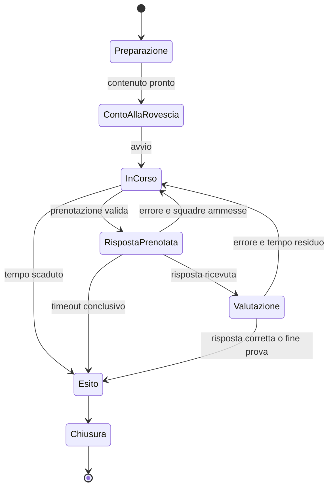
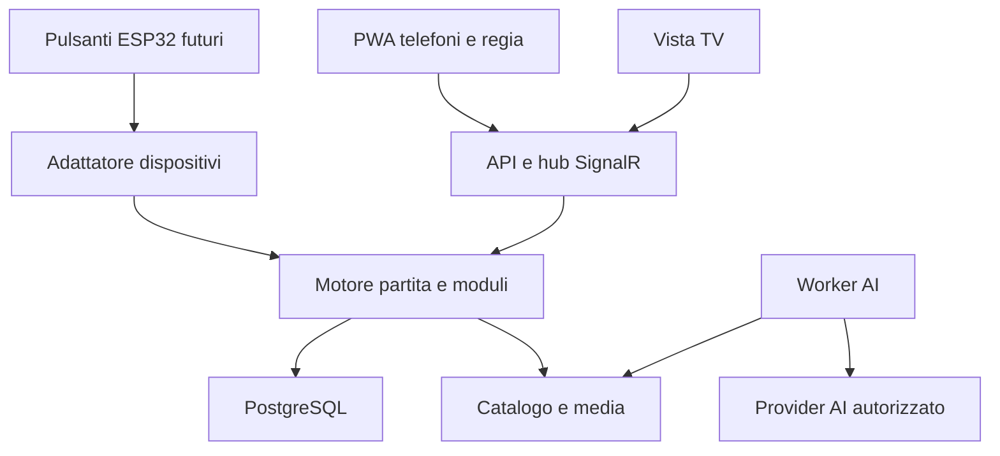

# MoscoGame — progetto del gioco e architettura della piattaforma

**Versione:** 0.1  
**Data:** 16 novembre 2026  
**Stato:** BOZZA DA VALIDARE  
**Repository:** [littlefly1969/MoscoGame](https://github.com/littlefly1969/MoscoGame)  
**Ambito di questa consegna:** progettazione funzionale e tecnica. L'implementazione software inizierà dopo la validazione dell'utente.

Le indicazioni marcate **Requisito** riprendono la richiesta. Le indicazioni marcate **Proposta** sono scelte iniziali modificabili. Le domande della sezione 20 raccolgono le decisioni ancora aperte. Numeri, punteggi e obiettivi prestazionali sono proposte da verificare, non risultati già misurati.

## 1. Visione del prodotto

**Requisito.** Creare una piattaforma multigioco di società, a squadre, utilizzabile in cloud e anche senza Internet, con giochi aggiungibili in modo modulare. Il primo gruppo comprende giochi di parole in stile Taboo, disegno in stile Pictionary, domande e morphing. Seguiranno mimo, riconoscimento di canzoni e altre attività.

Il prodotto deve offrire una serata di gioco continua: ingresso rapido, squadre riconoscibili, alternanza dei turni, attività comuni con prenotazione, punti e penalità, carte adatte a tema e difficoltà, schermate diverse per chi conduce, chi gioca e chi guarda.

**Proposta.** Nome di lavoro MoscoGame; esperienza iniziale da salotto, con persone nella stessa stanza. L'architettura cloud permette di aggiungere partecipanti remoti, ma audio/video tra giocatori e parità competitiva su reti molto diverse richiedono una fase dedicata.

La prima versione usa una classifica semplice. Il motore dovrà poter ospitare in seguito tabellone, caselle, bonus, malus ed eventi che modificano il flusso.

### Risultato atteso della prima versione personale

- Un amministratore crea la partita e sceglie giochi, temi, difficoltà e regole.
- I partecipanti entrano con QR o codice, scelgono una squadra e ricevono una vista coerente con il proprio ruolo.
- Una TV mostra attività pubblica, timer, prenotazione e classifica.
- I telefoni fungono da schermo personale, pulsante e, quando previsto, superficie di disegno.
- Le carte provengono da un catalogo oppure dall'AI, con controlli e riserva già pronta.
- La partita funziona in cloud oppure su un server locale; le modalità condividono le regole.
- I futuri pulsanti ESP32 si collegano allo stesso sistema di prenotazione dei telefoni.

## 2. Requisiti e confini iniziali

| ID | Requisito | Prima destinazione |
| --- | --- | --- |
| R01 | Backend C#/.NET, database PostgreSQL, frontend React | Fondazione |
| R02 | PWA installabile sui dispositivi compatibili | Fondazione e verifica browser |
| R03 | Moduli di gioco separati dal motore generale | Fondazione |
| R04 | Squadre, partecipanti, amministratore e visibilità differenziata | Prima partita completa |
| R05 | Attività di squadra e attività comuni con prenotazione | Prima partita completa |
| R06 | Guadagno/perdita punti e ricompensa maggiore alla squadra di turno | Prima partita completa |
| R07 | Catalogo di carte e generazione AI per ciascun gioco | Catalogo prima; AI dopo verifica integrazione |
| R08 | Uso personale del piano ChatGPT attraverso un flusso ufficiale idoneo | Verifica preliminare e connettore locale |
| R09 | Collegamento futuro a modelli tramite API | Contratti dalla fondazione; adattatori progressivi |
| R10 | Gioco senza Internet su più dispositivi | Prova tecnica iniziale; rilascio locale dedicato |
| R11 | Visualizzazione TV Android TV/Fire TV | Vista web prima; compatibilità hardware da provare |
| R12 | Pulsanti ESP32 a batteria, LED e buzzer | Contratto predisposto; hardware in fase successiva |
| R13 | Qualità industriale: sicurezza, test, ripristino, osservabilità | Progressiva, con criteri di accettazione |
| R14 | Difficoltà, argomenti e AI dinamica | Configurazione iniziale; adattamento sperimentale |

**Terminologia.** Si intende **PWA**, Progressive Web App: applicazione web installabile sui browser compatibili, con risorse disponibili localmente. La PWA è la parte client; il coordinamento di una partita richiede comunque un'autorità di gioco.

**Fuori dal primo rilascio:** tabellone articolato, pagamenti, marketplace di moduli, streaming audio/video, matchmaking pubblico, app native complete, generazione di immagini/video durante il conto alla rovescia, produzione definitiva dei dispositivi.

## 3. Ruoli, account e visibilità

Identità permanente, appartenenza alla squadra e ruolo nell'attività sono tre concetti distinti. Un partecipante può essere capitano nella partita e disegnatore soltanto nella prova corrente.

| Ruolo | Identità proposta | Capacità |
| --- | --- | --- |
| Amministratore della piattaforma | Account permanente | Configurazione installazione, contenuti, connettori e utenti |
| Organizzatore della partita | Account amministratore/organizzatore | Crea stanza, assegna squadre, configura e conduce |
| Arbitro | Incarico nella partita | Conferma esiti, contesta carte e applica rettifiche motivate |
| Squadra | Profilo con nome, colore, simbolo e membri | Unità che gioca, si prenota e riceve punti |
| Capitano / console di squadra | Accesso limitato alla squadra nella stanza | Prenotazione o risposta ufficiale, se questa modalità è selezionata |
| Componente | Account personale oppure identità ospite | Vede i dati consentiti e svolge il ruolo assegnato |
| Descrittore / disegnatore / mimo | Incarico temporaneo | Riceve il segreto necessario alla prova |
| Display TV | Dispositivo associato alla stanza | Riceve soltanto proiezioni pubbliche |
| Pulsante ESP32 | Identità tecnica revocabile | Prenota per la squadra assegnata e riceve feedback |

**Proposta sull'account squadra.** Prevedere un profilo persistente e una console utilizzabile con un solo telefono per squadra. L'accesso avviene con un invito circoscritto alla stanza; non richiede di condividere una password personale. Gli account dei singoli membri restano opzionali nella prova personale. Un futuro account squadra con credenziali proprie è una decisione separata.

### Matrice minima dei dati durante una prova

| Informazione | TV / spettatori | Giocatori che indovinano | Esecutore della prova | Arbitro designato |
| --- | --- | --- | --- | --- |
| Squadra di turno, timer, classifica | Sì | Sì | Sì | Sì |
| Domanda pubblica / immagine pubblica | Sì | Sì | Sì | Sì |
| Parola segreta Taboo / disegno | No | No, inclusi i compagni | Sì | Solo se necessario |
| Parole vietate | No | No | Sì | Sì, se incaricato del controllo |
| Soluzione di quiz o morphing | Dopo la chiusura | Dopo la chiusura | Nessun privilegio automatico | Sì, se deve giudicare |
| Risposta ancora da confermare | Solo quanto previsto dalle regole | Secondo ruolo | Secondo ruolo | Sì |
| Credenziali AI e dati amministrativi | No | No | No | Solo configurazione autorizzata, senza esposizione dei segreti |

Il backend produce viste dedicate per destinatario. Non si invia mai una carta completa a tutti affidando a React il compito di nasconderne la soluzione. La stessa separazione vale per URL di immagini, miniature, nomi file, log e cache.

**Organizzatore che gioca.** Proposta predefinita: organizzatore/arbitro non concorrente. Se partecipa, la sua vista di gioco nasconde le soluzioni e la valutazione passa a un altro arbitro oppure a regole automatiche adeguate. Un amministratore con accesso al database resta un soggetto fidato: non si promette protezione contro il gestore dell'infrastruttura.

## 4. Struttura della partita e flusso generale

### 4.1 Oggetti di gioco

- **Partita:** stanza con squadre, configurazione, classifica, sequenza dei turni e stato salvato.
- **Turno:** opportunità assegnata alla squadra corrente.
- **Attività:** una prova estratta da un modulo; può coinvolgere la sola squadra corrente oppure tutte le squadre.
- **Carta:** contenuto versionato selezionato per l'attività.
- **Tentativo:** prenotazione e risposta di una squadra.
- **Esito:** risultato confermato da regole o arbitro.
- **Movimento punti:** variazione motivata e registrata nella classifica.

### 4.2 Regola fondamentale proposta

Le squadre ruotano in un ordine fissato all'avvio. Per ogni turno viene selezionata un'attività tra i giochi abilitati:

1. Il server sceglie modulo, modalità e carta ammissibile.
2. I ruoli ricevono i rispettivi contenuti durante la preparazione.
3. Dopo il conto alla rovescia inizia la prova.
4. In una prova di squadra risponde soltanto la squadra corrente.
5. In una prova comune possono prenotarsi tutte le squadre ammesse.
6. Si determina l'esito, si registrano i punti e si mostra il risultato.
7. Il turno passa alla squadra successiva, anche se ha vinto una squadra diversa.

**Proposta:** il vincitore di una prova comune non ottiene automaticamente il turno successivo. La rotazione resta prevedibile. Un futuro modificatore potrà introdurre questo effetto.

### 4.3 Stati dell'attività

Le prove senza prenotazione passano da InCorso alla valutazione/esito secondo il modulo. Pausa e annullamento sono comandi controllati del motore, consentiti negli stati previsti e registrati; non sono lasciati alla sola interfaccia.

### 4.4 Selezione attività, durata e fine partita

**Proposte iniziali:**

- Scelta ponderata fra i moduli abilitati, con regola che limita ripetizioni consecutive.
- Bilanciamento del numero di attività di squadra/comuni e della difficoltà tra le squadre.
- Sequenza e seed registrati per audit; contenuti e ordine futuro restano sul server.
- Carte non ripetute nella stessa partita; mazzo esaurito segnalato esplicitamente.
- Fine predefinita dopo un numero configurabile di giri completi, così ogni squadra ha lo stesso numero di turni.
- Varianti future: tempo totale o punteggio obiettivo; al termine si completa il giro se previsto.
- Parità inizialmente classificata ex aequo; spareggio opzionale con sole attività comuni.

## 5. Punteggi, prenotazione e penalità

### 5.1 Profilo iniziale da bilanciare con prove reali

| Evento | Proposta |
| --- | --- |
| Carta Taboo indovinata entro il tempo | +1 alla squadra corrente per carta |
| Uso confermato di parola vietata | -1 e cambio carta |
| Passaggio carta Taboo | 0; limite configurabile |
| Pictionary riuscito | +3 alla squadra corrente |
| Pictionary scaduto | 0 |
| Prova comune: corretta della squadra di turno | +3 |
| Prova comune: corretta di altra squadra | +2 |
| Prova comune: risposta errata / timeout di risposta | -1 e blocco squadra per quella attività |
| Nessuna risposta entro la fine | 0 |
| Attività annullata per contenuto errato | Nessun effetto netto sui punti di quella attività |

**Proposta:** punteggi negativi consentiti. Penalità, bonus e limiti sono parametri del profilo di regole salvato nella partita. I valori dei diversi giochi dovranno essere bilanciati per tempo, difficoltà e quantità di carte: +1 per carta e +3 per una prova singola sono valori di partenza.

Il motore registra un elenco di movimenti punti con motivo, squadra, attività e autore. Una rettifica aggiunge un movimento compensativo collegato all'originale; non cancella la storia. Una stessa chiusura, ripetuta per errore di rete, non attribuisce punti due volte.

### 5.2 Prenotazione per le prove comuni

- Si prenota la **squadra**. Più telefoni della stessa squadra generano al massimo una prenotazione valida.
- Impostazione proposta: tutti i membri possono premere; il capitano o un portavoce dà la risposta. È disponibile la variante con sola console di squadra.
- Il server apre una finestra identificata e accetta soltanto richieste dell'attività e della finestra correnti.
- Vince la prima richiesta valida elaborata dall'autorità di gioco; la selezione è atomica.
- La conferma del server accende il segnale di prenotazione sui telefoni, sulla TV e sui futuri pulsanti.
- La squadra ha una finestra di risposta proposta di 8 secondi, comunque entro la scadenza generale.
- Risposta sbagliata o tempo di risposta esaurito: -1, esclusione della squadra da questa attività e riapertura alle altre, se resta tempo.
- Risposta corretta: chiusura della prova e attribuzione del premio.
- Se tutte le squadre sono escluse o scade il tempo generale, la prova termina.
- L'arbitro può sospendere prima della scadenza mentre valuta una risposta; la pausa ferma i timer dell'attività e viene registrata. Un invio effettuato dopo la scadenza effettiva non diventa valido grazie a una pausa successiva.

**Equità.** L'ordine di arrivo al server non coincide sempre con l'ordine fisico dei tocchi. Non si usano gli orologi dei telefoni per decidere il vincitore. Per il salotto competitivo si preferisce l'autorità locale con tutti i dispositivi sulla stessa LAN; si misurano anche differenze tra pulsanti e telefoni. Un'eventuale modalità remota competitiva richiederà regole esplicite per la latenza.

### 5.3 Esempio concreto

La squadra A è di turno e compare un quiz comune. B si prenota, sbaglia e perde 1 punto; B resta esclusa da quel quiz. A si prenota e risponde correttamente: guadagna 3 punti. L'attività finisce e il turno passa a B. Se avesse risposto correttamente C, C avrebbe guadagnato 2 punti e il turno sarebbe comunque passato a B.

## 6. Moduli iniziali

| Modulo | Modalità iniziale | Contenuto necessario | Interazione e riservatezza | Durata proposta |
| --- | --- | --- | --- | --- |
| Parole vietate, stile Taboo | Di squadra | Parola obiettivo, 5 parole vietate, difficoltà e tema | Descrittore vede la carta; compagni indovinano; arbitro verifica | 60 s, più carte |
| Disegno, stile Pictionary | Di squadra | Soggetto, categorie e criteri di accettazione | Disegnatore vede il soggetto; disegno pubblico; parola nascosta | 90 s, una carta |
| Domande | Comune | Domanda, soluzione, varianti accettate, spiegazione e fonti quando necessarie | Domanda pubblica, prenotazione, giudizio | 30 s |
| Morphing | Comune, da confermare | Media, sequenza della trasformazione, soluzione e licenza | Media sulla TV e prenotazione; soluzione nascosta | 30 s |

### 6.1 Parole vietate

Possibili difficoltà: numero/forza delle parole vietate, astrattezza del soggetto e tempo. Un arbitro può contestare una parola vietata, con conferma esplicita; un riconoscitore vocale non è necessario al primo rilascio.

La carta successiva viene inviata al descrittore soltanto quando la precedente viene chiusa. Il server controlla tempo e punteggio dell'intera attività.

### 6.2 Disegno

**Proposta iniziale:** disegno su telefono/tablet, riprodotto sulla TV; variante con lavagna fisica e timer digitale. Il tratto viene visualizzato subito sul dispositivo del disegnatore e trasmesso agli altri con aggiornamenti raggruppati.

I punti del tratto usano coordinate normalizzate. Sono previsti gomma, annulla e cancella. Il server controlla identità del disegnatore, frequenza e dimensione dei messaggi; conserva checkpoint del disegno per i rientri. Il soggetto non deve finire nel nome della tela o nei suoi metadati pubblici.

### 6.3 Domande

Prima versione: domanda aperta, risposta orale e conferma dell'arbitro. Il modulo può aggiungere risposte scritte e scelta multipla senza cambiare il motore.

Per correzioni automatiche si usano prima risposte e varianti autorizzate nella carta. L'AI può suggerire un giudizio sulle formulazioni aperte; la decisione contestabile resta all'arbitro.

### 6.4 Morphing: definizione ancora aperta

**Assunzione provvisoria:** riconoscere un soggetto mentre un'immagine si trasforma o viene progressivamente rivelata. Va chiarito se si intende transizione fra due soggetti, fusione di volti, immagini deformate o un altro meccanismo.

Il modulo espone una timeline di media e una soluzione; il tipo di trasformazione resta configurabile. Durante la prenotazione si può fermare l'immagine, mentre il tempo generale continua, salvo pausa dell'arbitro.

Il primo prototipo userà media predisposti. AI testuale, generazione immagini e trasformazione di immagini sono capacità distinte: un modello linguistico generico non è sufficiente a produrre ogni tipo di media. Niente generazione pesante nel percorso critico della prova.

### 6.5 Moduli successivi

Mimo riutilizza segreto personale e timer. Indovina la canzone riutilizza media pubblici, prenotazione e punteggio comune; catalogo, disponibilità offline e diritti dei brani devono essere definiti prima del rilascio del modulo.

I riferimenti a Taboo e Pictionary descrivono il tipo di meccanica. Nome commerciale, grafica, regole editoriali e cataloghi del prodotto dovranno essere originali o utilizzabili con autorizzazione; non si assume di poter importare mazzi commerciali.

## 7. Esperienza visiva e uso dei dispositivi

**Direzione proposta:** sala giochi contemporanea, sfondo scuro, accenti vivaci, carte grandi, animazioni brevi, suoni riconoscibili e forte identità delle squadre. Una famiglia grafica comune collega tutti i minigiochi.

| Superficie | Priorità |
| --- | --- |
| Telefono giocatore | Un'azione principale evidente, pulsante grande, ruolo e stato chiari |
| Telefono esecutore | Carta segreta leggibile, protezione dal mostrare accidentalmente il contenuto |
| Console squadra | Prenotazione, nome squadra, stato del portavoce e risposta |
| Regia organizzatore | Avvio, assegnazione ruoli, pausa, esiti, dispositivi connessi e rettifiche |
| TV | Attività pubblica, timer, squadra di turno, prenotazione e classifica leggibili da lontano |
| Catalogo carte | Ricerca, filtri, revisione, provenienza, qualità e importazione |

Accessibilità: simboli insieme ai colori, contrasto adeguato, opzione movimento ridotto, testo ridimensionabile, vibrazione/audio opzionali e navigazione senza touch dove necessaria. Interfaccia iniziale italiana; struttura pronta alla localizzazione.

La PWA deve segnalare chiaramente connessione persa, riconnessione, ruolo cambiato e contenuti offline incompleti. Non deve mostrare una prenotazione come vincente prima della conferma del server.

### TV, Android TV e Fire TV

Prima base verificabile: vista TV nel browser di un computer collegato via HDMI. La vista TV si associa con codice o QR tramite la regia e riceve un'identità di sola visualizzazione.

Browser disponibile, telecomando, fullscreen, audio e installabilità PWA su Android TV/Fire TV dipendono dal dispositivo. Un browser web e una PWA non garantiscono automaticamente un'app TV installabile. Si proverà l'hardware reale; un successivo contenitore Android/Fire TV potrà riutilizzare la vista React. Cast/mirroring sono possibili opzioni da collaudare, non il solo percorso previsto.

## 8. Architettura tecnica proposta

### 8.1 Scelte principali

| Area | Proposta | Motivazione |
| --- | --- | --- |
| Backend | C# su .NET 10 LTS e ASP.NET Core | Base supportata per API, autorizzazioni e servizi; politica verificata [S1] |
| Realtime | ASP.NET Core SignalR con client TypeScript | Comunicazione server/client e destinatari selezionati [S3] |
| Persistenza | PostgreSQL 18, EF Core e provider Npgsql compatibili | Relazioni, transazioni, dati di gioco e payload JSONB [S2] |
| Frontend | React + TypeScript, build Vite e PWA | Viste per telefono, regia e TV; installazione dove supportata |
| Stato client | Query per dati server e store limitato alla UI | L'autorità del gioco resta nel backend |
| Disegno | Canvas con protocollo di tratti | Feedback locale rapido e riproduzione sugli altri schermi |
| Media | Archivio file locale e object storage in cloud | Pacchetti offline, immagini e audio fuori dalle tabelle principali |
| Attività AI | Worker .NET con coda persistita e adattatori | Generazione fuori dal percorso della prenotazione |
| Deploy iniziale | Container per applicazione, PostgreSQL e reverse proxy | Ambienti riproducibili in cloud e sul server locale |
| Osservabilità | Log strutturati, metriche e tracing OpenTelemetry | Diagnosi dei problemi di partita e dei connettori |
| Contratti | API HTTP versionate, OpenAPI ed eventi realtime versionati | Integrazione frontend, dispositivi e compatibilità |

Le versioni patch e le dipendenze React/EF Core/Npgsql saranno fissate nel progetto software dopo una verifica congiunta di supporto e compatibilità. Nessuna dipendenza obbligatoria da uno specifico servizio cloud.

### 8.2 Monolite modulare come base

**Proposta:** un backend distribuibile con moduli interni e confini chiari. Una soluzione industriale richiede affidabilità e contratti verificabili; il primo rilascio non richiede un servizio indipendente per ogni gioco.

Moduli funzionali:

- Identità e accessi.
- Stanze, squadre e partecipanti.
- Motore di partita, turni, timer e modificatori.
- Punteggi e arbitraggio.
- Catalogo contenuti, revisioni e pacchetti.
- Orchestrazione AI.
- Registro dei giochi e relativi adattatori.
- Display e dispositivi.
- Salvataggio, esportazione e sincronizzazione.

Il dominio resta separato da HTTP, SignalR, PostgreSQL e provider AI. API e hub sono ingressi dello stesso livello applicativo: non duplicano le regole.

### 8.3 Relazioni fra i componenti

Il diagramma descrive una singola autorità, eseguita nel cloud oppure sul server locale. Il worker prepara contenuti; soltanto il motore può cambiare stato di gioco e punti.

## 9. Contratto dei moduli e modificatori futuri

Ogni modulo dichiara ID, versione, modalità ammesse, schema della carta, ruoli, capacità richieste, durata e regole di visibilità. Offre operazioni per preparare la prova, validare azioni, produrre esiti e costruire le viste autorizzate.

| Responsabilità | Motore comune | Modulo di gioco |
| --- | --- | --- |
| Stanze, identità e turnazione | Sì | Usa i contratti |
| Apertura e assegnazione prenotazione | Sì | Dichiara se necessaria |
| Validazione carta | Schema comune | Vincoli specifici |
| Timer | Infrastruttura comune | Durate e condizioni previste |
| Valutazione | Applica esito autorizzato | Interpreta regole della prova |
| Punti | Registra movimenti una sola volta | Propone esiti previsti dal profilo |
| Informazioni segrete | Applica autorizzazione | Definisce segreti e destinatari |
| Rendering | Shell e componenti condivisi | Viste specifiche React |

**Modularità iniziale:** moduli fidati inclusi nella build e registrati esplicitamente. Aggiungere un gioco può richiedere aggiornare backend e frontend; non si promette caricamento di codice arbitrario a runtime.

Una partita salva le versioni di modulo, carta e regole. Un aggiornamento non modifica una partita in corso. I pacchetti dichiarano la compatibilità con il motore.

**Estensione per tabellone/eventi:** punti di intervento prima della selezione attività, prima dell'avvio, dopo l'esito e prima del cambio turno. I modificatori sono ordinati, versionati e con effetti controllati. Il motore impedisce bonus doppi, cicli di turni infiniti e combinazioni incompatibili. L'AI potrà suggerire eventi soltanto fra azioni autorizzate.

## 10. Realtime, concorrenza e ripristino

**Risposta alla domanda tecnologica:** .NET e React sono adeguati per questo genere di tempo reale aggiungendo SignalR. SignalR supporta WebSocket e trasporti alternativi; non sostituisce il motore di stato e le verifiche dei comandi [S3].

### 10.1 Una sola autorità per partita

- Il server decide ordine delle azioni, stato, timer, prenotazione ed esito.
- Ogni comando porta identificativo univoco, partita, attività e versione attesa quando serve.
- L'attore è ricavato dalla sessione autenticata; una squadra dichiarata dal client non viene considerata attendibile.
- I cambiamenti di stato sono serializzati per partita e confermati in transazione.
- Una prenotazione usa una condizione atomica sullo stato; l'assegnazione non dipende da due controlli separati.
- Un vincolo persistente e una chiave di idempotenza impediscono doppi tentativi o doppi punti.
- Stato, movimenti punti ed eventi da pubblicare vengono salvati insieme, con outbox transazionale.
- La consegna può ripetersi: client e consumatori deduplicano gli eventi tramite ID/versione.

Una coda in memoria può ordinare le richieste nel singolo processo; la correttezza non dipende soltanto da quella coda. Una seconda istanza richiederà proprietà esclusiva della stanza, lease/fencing o partizionamento verificabile. Un backplane SignalR distribuisce messaggi ma non risolve la concorrenza di gioco.

### 10.2 Timer e riconnessione

Il server trasmette stato, ora di riferimento, scadenze e tempo residuo in pausa. Il client disegna il conto alla rovescia con un orologio monotono ricalibrato; l'invio di un evento ogni secondo non è necessario.

Alla riconnessione, il server rivalida appartenenza e ruolo e invia una nuova vista autorizzata con versione corrente. Non si presume che i messaggi persi siano stati consegnati. I gruppi SignalR sono strumenti di instradamento, non un confine di autorizzazione [S4].

Un telefono sospeso dal sistema operativo non può garantire una connessione continua. Al rientro la UI recupera lo stato; per il gioco attivo si raccomanda lo schermo in primo piano, con blocco spegnimento dove supportato e un comportamento di fallback.

**Proposta di ripristino:** dopo riavvio del server una prova incompleta torna in pausa e richiede conferma della regia. Si conservano i punti già confermati; nessun timeout ambiguo viene convertito automaticamente in penalità durante il fermo.

## 11. Cloud e gioco senza Internet

### 11.1 Modalità operative

| Modalità | Autorità | Requisiti | AI e contenuti |
| --- | --- | --- | --- |
| Cloud | Backend remoto | Internet per i partecipanti | Catalogo e AI online autorizzata |
| Locale con Internet | Server su PC/mini PC | LAN comune; Internet facoltativo per il gioco | Catalogo locale e possibile connettore ChatGPT personale |
| Locale senza Internet | Stesso server locale | LAN/Wi-Fi attiva, server e pacchetti disponibili | Carte/media scaricati; modello locale futuro opzionale |
| Solo dispositivo, futura | Runtime dedicato o modalità pratica | Progetto separato da definire | Non copre il multiplayer locale richiesto |

**Scelta proposta:** per il multiplayer senza Internet usare un server locale .NET con PostgreSQL, avviabile sul PC dell'organizzatore. Telefoni e TV si collegano alla sua rete. Un telefono browser non diventa automaticamente un server .NET/PostgreSQL per tutti gli altri.

La PWA conserva shell e risorse necessarie; il database sul server conserva lo stato autorevole. Senza Internet e senza rete locale, dispositivi separati non possono coordinare una partita con questa architettura.

### 11.2 Preparazione di una serata offline

1. Installare e verificare server locale, database e reverse proxy.
2. Predisporre LAN senza isolamento fra client, nome locale e HTTPS attendibile sui dispositivi.
3. Importare/scaricare pacchetti di carte e tutti i media necessari.
4. Eseguire il controllo di compatibilità, integrità e spazio disponibile.
5. Associare regia, telefoni e display; provare ingresso e riapertura anche senza WAN.
6. Avviare la partita con profilo offline e generazione cloud disabilitata.
7. Salvare localmente ed esportare risultati quando utile.

Font, icone, librerie e media essenziali devono essere inclusi: nessuna dipendenza runtime da CDN nella modalità offline.

### 11.3 Vincolo importante: HTTPS nella LAN

Service worker e installabilità richiedono HTTPS oppure l'eccezione localhost sul dispositivo che apre la pagina [S5]. L'indirizzo privato del PC raggiunto da un telefono non è localhost del telefono.

Serve quindi una soluzione verificata per certificato e nome del server locale: ad esempio certificato installato come attendibile sui dispositivi della prova personale, oppure dominio e certificato predisposti prima della serata con risoluzione locale. Vanno testati Android, iOS e display reali; se l'esperienza di installazione risulta scomoda, si valuterà un contenitore applicativo successivo. Non basta ignorare un avviso del browser per dichiarare risolta la PWA.

### 11.4 Perdita di rete e sincronizzazione

- Una partita nata nel cloud si mette in attesa alla perdita di connessione e riprende sullo stesso server.
- Una partita nata sul server locale continua alla perdita della WAN.
- Il primo rilascio non effettua migrazione automatica cloud-locale nel mezzo di una prova.
- Un eventuale passaggio manuale richiede pausa, checkpoint confermato e disattivazione dell'autorità precedente; sarà una funzione successiva.
- I comandi competitivi, soprattutto prenotazioni e risposte, non vengono accodati offline per riprodurli più tardi.
- Risultati locali e pacchetti possono essere importati nel cloud con identificativi univoci e deduplicazione.
- Una sincronizzazione non fonde due storie divergenti della stessa partita.
- Cache cloud e cache locale appartengono a origini diverse; la presenza dell'una non garantisce la disponibilità dell'altra.

Le cache client non contengono interi mazzi segreti. Il server locale custodisce i pacchetti; i client ricevono solo il contenuto necessario al ruolo e alla prova.

## 12. Contenuti e catalogo delle carte

Ogni gioco offre tre strategie selezionabili: **catalogo**, **generazione diretta**, **ibrida**. Nella modalità ibrida l'AI prepara contenuti in anticipo e il catalogo offre una riserva valida.

### 12.1 Modello della carta

Campi comuni proposti: ID e versione, modulo/schema, lingua, tema, difficoltà editoriale, fascia di pubblico, titolo interno, payload specifico, risposte accettate, classificazione dei segreti, media, provenienza, licenza, stato di revisione, impronta antiripetizione e data di validità quando rilevante.

**Campi AI aggiuntivi:** provider/modello, versione prompt, configurazione di generazione, verifiche eseguite, rapporti di revisione, eventuali fonti, revisore umano e consumi registrati quando disponibili. Le chiavi e i token non fanno parte della carta.

Il database mantiene separati i contenuti pubblici dalle viste di risposta. Un payload JSONB specifico del modulo resta soggetto a schema e versione; non è un contenitore privo di controlli.

### 12.2 Ciclo di vita e pacchetti

Stati proposti: bozza, generata, verificata automaticamente, in revisione, approvata, respinta, in quarantena, ritirata. Le carte approvate sono disponibili per partite affidabili; modificare una carta crea una nuova revisione.

Importazione/esportazione iniziale in JSON con validazione, anteprima ed errori per riga/elemento. Formati CSV potranno essere aggiunti per carte semplici. I pacchetti includono manifest, versioni richieste, checksum, licenze e media; l'importatore impone limiti di dimensione e impedisce percorsi file non consentiti.

Si registrano le carte già usate nella partita; la memoria d'uso tra serate è opzionale. Se i filtri esauriscono il catalogo, la regia sceglie se cambiare filtri, importare o generare: niente ripetizioni nascoste.

## 13. AI: accesso personale, API e uso dinamico

### 13.1 Account di gioco e account AI restano separati

**Requisito:** provare inizialmente il proprio abbonamento ChatGPT, mantenendo la futura apertura a modelli via API.

**Verifica documentale al 16 novembre 2026.** OpenAI descrive Sign in with ChatGPT e l'autorizzazione separata all'uso del piano. La disponibilità documentata include progetti personali locali e integrazioni open source; applicazioni commerciali o ospitate da remoto hanno condizioni di accesso specifiche [S6][S7]. L'idoneità dell'account e dell'installazione MoscoGame va verificata con una richiesta realmente completata.

**Proposta:** sperimentare un connettore sul PC personale, con autenticazione ufficiale e credenziali custodite localmente. Non trasferire automaticamente questa possibilità a un servizio cloud pubblico. Il solo login non autorizza richieste AI; occorre il consenso previsto.

Le normali API OpenAI hanno fatturazione distinta dall'abbonamento ChatGPT [S8]. Quote, benefici o promozioni dipendono dal piano; nessuna generazione illimitata è assunta.

### 13.2 Strategia dei connettori

| Connettore | Destinazione | Condizioni e fallback |
| --- | --- | --- |
| ChatGPT personale locale | Prima sperimentazione personale | Flusso ufficiale, idoneità e quote verificate; ripiego su catalogo |
| Provider API configurato | Cloud e futura versione pubblica | Credenziali protette, limiti e budget espliciti |
| Endpoint compatibile | Modelli/servizi alternativi | Compatibilità dichiarata e verificata per capacità |
| Modello locale | Futuro offline con AI | Hardware, qualità e prestazioni da valutare |
| Importazione manuale | Preparazione personale alternativa | Carte generate dall'utente e importate con revisione |

L'astrazione distingue generazione testuale strutturata, immagini, trasformazioni, audio, revisione e ricerca con fonti. Ogni provider dichiara le capacità disponibili. Una semplice URL compatibile non garantisce schema, strumenti o qualità equivalenti.

Connettori sul server o sul runtime locale autorizzato; token fuori da bundle React, localStorage, URL e log. Il runtime gestisce revoca, rinnovo e indisponibilità. Una futura associazione fra runtime personale e partita cloud richiederebbe un canale ristretto a lavori di generazione autorizzati: non è necessaria per il primo prototipo locale.

Non si prevedono estrazione di cookie, condivisione di credenziali o automazione della pagina ChatGPT come interfaccia backend.

### 13.3 Livelli di impiego dell'AI

| Livello | Funzione | Prima collocazione |
| --- | --- | --- |
| A — Preparazione | Generare mazzi per tema, lingua, pubblico e difficoltà | Primo uso, con revisione |
| B — Generazione diretta | Preparare la prossima carta durante la partita | Dopo collaudo; buffer e fallback |
| C — Adattamento | Proporre difficoltà o argomenti in base agli esiti | Sperimentazione misurata |
| D — Azioni dinamiche | Suggerire varianti/eventi fra azioni consentite | Fase successiva con conferma regia |

Il timer parte soltanto quando contenuto e risorse sono pronti e la prova può essere avviata. La generazione non blocca prenotazioni o assegnazione punti. Timeout, quota esaurita o carta respinta attivano una carta pronta con filtri compatibili; se manca, la regia riceve una richiesta di scelta prima dell'avvio.

**Adattamento equo:** difficoltà inizialmente scelta dall'organizzatore. Successivamente si possono usare frequenza di successo, tempo di risposta e giudizi sulle carte; un suggerimento AI resta entro limiti fissati, viene registrato e si applica preferibilmente fra giri completi. Non si altera in segreto il vantaggio di una squadra.

**Azioni dinamiche:** l'AI propone un tipo di azione e parametri validati. Il motore controlla prerequisiti, limiti e compatibilità; solo dopo l'eventuale conferma applica l'effetto. Nessuna esecuzione di codice prodotto dal modello e nessuna riscrittura libera delle regole.

## 14. Verifica della qualità delle carte AI

La qualità è un requisito centrale. Una seconda risposta dello stesso modello non è una prova di correttezza: può ripetere lo stesso errore. Il processo combina controlli deterministici, riscontri e revisione umana.

### 14.1 Procedura proposta

1. **Generazione strutturata:** contenuto secondo lo schema del modulo e i parametri richiesti.
2. **Validazione formale:** campi obbligatori, limiti, lingua, file/media esistenti e compatibilità.
3. **Controlli specifici:** duplicati, parola obiettivo fra quelle vietate, forme linguistiche, risposta mancante, ambiguità rilevabili e segreti nei campi pubblici.
4. **Revisione critica separata:** nuova richiesta con rubrica di valutazione e rapporto dei difetti; opzionalmente modello/provider diverso per ridurre errori correlati.
5. **Verifica fattuale per i quiz:** riscontro della soluzione su fonti affidabili dove necessario. Un URL inventato dal modello non conta come fonte verificata.
6. **Revisione umana:** richiesta per pubblicare un mazzo stabile. Chi approva un mazzo non dovrebbe poi ricevere un vantaggio competitivo nella stessa serata.
7. **Monitoraggio in partita:** segnalazione della carta, annullamento dell'attività quando necessario e quarantena prima del riuso.
8. **Valutazione periodica:** confronto con un insieme di carte controllate e casi difettosi, prima di cambiare modello o prompt.

### 14.2 Rubrica per gioco

| Modulo | Difetti da cercare |
| --- | --- |
| Parole vietate | Parola segreta ripetuta, vietate duplicate o inutili, difficoltà incoerente, soggetto incomprensibile |
| Disegno | Soggetto difficilmente rappresentabile, più interpretazioni incompatibili, istruzioni che rivelano la soluzione |
| Domande | Falso fattuale, domanda ambigua, risposta non univoca, nozione scaduta, varianti legittime non accettate |
| Morphing | Media errato/mancante, soluzione riconoscibile solo per errore, risposta nel nome file, trasformazione inutilizzabile, provenienza mancante |

**Modalità affidabile:** catalogo approvato. **Modalità sperimentale:** generazione durante la partita, verificata automaticamente, esplicitamente abilitata e contestabile; non viene presentata come equivalente a una revisione umana.

L'organizzatore che gioca non deve vedere in anticipo la carta per approvarla. In quel caso si usa catalogo preparato da altri oppure si accetta il rischio della modalità sperimentale con un arbitro appropriato.

Obiettivo di valutazione iniziale proposto: campione umano di almeno 50 carte per ciascun modulo testuale, più un insieme di errori intenzionali. Si misurano validità dello schema, errori fattuali/ambiguità, adeguatezza della difficoltà, duplicazioni, costo e tempo di generazione. I casi gravi noti devono essere respinti; non si promette assenza assoluta di errori su contenuti nuovi.

Le richieste AI trattano temi e materiale importato come dati, con strumenti e accessi limitati. Il modello non riceve credenziali né un accesso libero al database della partita.

## 15. Modello dati concettuale

| Entità | Scopo e vincoli principali |
| --- | --- |
| User / ExternalIdentity | Account interno e identità esterne; collegamento con identificatore verificato |
| GameSession | Stanza, autorità, stato, configurazione e versione |
| Team / TeamMembership | Profilo squadra e appartenenza nella sessione |
| Participant / SessionRole | Identità ospite o utente, ruolo e permessi correnti |
| GameDefinition / GameModuleVersion | Modulo, capacità e versione compatibile |
| RulesetVersion | Punteggi, limiti, selezione e modificatori congelati per partita |
| Turn / Activity | Squadra di turno, modulo, carta, ruoli, scadenze e stato |
| Card / CardRevision | Identità della carta, payload immutabile e ciclo di revisione |
| ContentPack / MediaAsset | Pacchetti, integrità, file, provenienza e disponibilità |
| BuzzAttempt / AnswerAttempt | Richiesta, finestra, squadra, esito e idempotenza |
| ScoreEntry | Movimento punti firmato dal comando applicativo e motivo |
| Device / DeviceAssignment | Display o pulsante, credenziali e associazione a stanza/squadra |
| AiConnection / GenerationJob | Riferimento protetto al provider e lavoro di generazione |
| ValidationReport / ContentFeedback | Controlli, difetti, revisione e segnalazioni |
| OutboxEvent / AuditEntry | Pubblicazione affidabile e operazioni rilevanti |
| SessionCheckpoint / ImportReceipt | Ripristino, esportazione e deduplicazione import |

Relazioni e vincoli fanno riferimento alla partita: appartenere alla squadra X in una stanza non autorizza accesso a un'altra. Timestamp di persistenza in UTC e formattazione locale nell'interfaccia. UUID o identificativi equivalenti per importazione senza collisioni.

PostgreSQL conserva dati transazionali e metadati. File multimediali restano nello storage, con riferimenti opachi e controlli di accesso. La cronologia dei punti e l'audit non implicano un'architettura event sourcing completa.

## 16. Pulsanti interattivi ESP32

**Requisito:** progettare in seguito dispositivi a batteria ricaricabile, con pulsante, eventuali LED e buzzer, usando ESP32 e contenitore stampato in 3D.

### 16.1 Contratto funzionale da predisporre

Ogni dispositivo può: associarsi a una squadra, indicare stato e batteria quando misurabile, prenotare, ricevere conferma, mostrare vincitore/blocco e segnalare disconnessione. Non conserva soluzioni o account AI.

La pressione ha ID/contatore e finestra di attività; il server verifica associazione e ammissibilità. Una pressione ricevuta due volte resta un solo tentativo. Debounce e feedback locale distinguono “premuto/inviato” da “prenotazione assegnata”.

### 16.2 Comunicazione proposta

ESP32 con Wi-Fi verso un adattatore dispositivi .NET, tramite un protocollo WebSocket dedicato e semplice, autenticato. Non si impone all'ESP32 di implementare il protocollo SignalR. MQTT con broker locale e TLS resta un'alternativa supportabile tramite adattatore; Espressif documenta il relativo client [S9].

Un solo protocollo verrà scelto con una prova di latenza, riconnessione e consumo. Il dispositivo non può selezionare arbitrariamente un'altra squadra o ottenere permessi da organizzatore. Associazione breve, credenziali per dispositivo e possibilità di revoca.

### 16.3 Fasi hardware successive

1. Inventario di schede, batterie e componenti effettivamente disponibili.
2. Scelta pulsante, circuito di alimentazione/ricarica e protezione compatibili con la batteria.
3. Prototipo da banco con misure di tensione, consumo, latenza e stabilità Wi-Fi.
4. Definizione dei pattern LED/buzzer e modalità di risparmio.
5. Contenitore stampabile con accessibilità di pulsante, interruttore e ricarica.
6. Test con più squadre, urti d'uso, interferenze e sessioni prolungate.
7. Eventuale aggiornamento firmware controllato.

Nessuna autonomia numerica viene fissata prima di conoscere capacità della batteria, scheda, LED e duty cycle. Durante una prova il dispositivo deve restare pronto alla prenotazione; il deep sleep si riserva alle fasi compatibili. La distinta base e i file 3D saranno consegne separate.

## 17. Sicurezza, affidabilità e qualità industriale

### 17.1 Sicurezza applicativa

- Login proprio per organizzatore; ospiti con permessi minimi e inviti revocabili.
- Codice stanza per trovare la partita; ingresso approvato o invito protetto per ottenere un ruolo. Un codice breve da solo non autorizza operazioni amministrative.
- Sessioni web con cookie protetti, policy CSRF/CORS/origini e autorizzazione dei comandi.
- Verifica corrente di ruolo, squadra e stato anche sugli hub; revoche applicate alle connessioni attive.
- Cache pubbliche e cache personali separate, pulizia al logout/cambio ruolo, soluzioni escluse dalla cache indiscriminata del service worker.
- Segreti in archivio protetto locale o servizio dedicato; chiavi di protezione persistenti e backup coerenti.
- Limiti su tentativi di ingresso, messaggi, caricamenti, URL e richieste AI.
- Isolamento tra stanze e, in futuro, organizzazioni.
- Importazione contenuti e media con validazione di tipo, dimensione e destinazione.
- Raccolta minima di dati: nickname e squadra possono bastare per gli ospiti.

La versione pubblica richiederà anche scelte esplicite su conservazione/cancellazione dati, contenuti per fasce d'età, condizioni del servizio e licenze dei media. Questi aspetti saranno verificati prima della pubblicazione.

### 17.2 Affidabilità e operatività

- Migrazioni database versionate e strategia di aggiornamento/ripristino.
- Backup del database e dei media con prova di ripristino.
- Stato, punti e idempotenza persistenti; nessuna dipendenza dalla memoria di un solo processo per i dati confermati.
- Deploy tra partite, compatibilità dei client e blocco degli aggiornamenti PWA invasivi durante una prova.
- Health check, metriche di connessione, latenza, errori di autorizzazione, coda AI e contenuti esauriti.
- Log senza token, risposte segrete o dati personali superflui.
- Ambienti separati di sviluppo, collaudo e produzione; configurazione esterna e riproducibile.
- Pipeline con build, analisi, verifica dipendenze e test richiesti dalla modifica.

### 17.3 Verifiche software che contano

Test sulle regole di rotazione e punteggio; due prenotazioni concorrenti; riinvio dello stesso comando; timer/scadenze; passaggio di ruolo; mancata diffusione di soluzioni; arresto dopo commit e prima dell'evento; rientro del client; import di pacchetto difettoso.

Integrazione su PostgreSQL reale per transazioni e vincoli; prove end-to-end con più browser e ruoli; collaudo su telefoni/TV reali. Non basta verificare ogni schermata singolarmente.

## 18. Dimensionamento e criteri di accettazione proposti

**Profilo personale di riferimento:** 2–6 squadre, fino a 24 giocatori, una regia e una TV. Primo esercizio cloud su una singola istanza; benchmark iniziale proposto su 10 stanze contemporanee con quel profilo. Sono obiettivi da misurare su hardware e rete dichiarati.

| Criterio | Verifica proposta |
| --- | --- |
| Realtime LAN | Conferma di prenotazione p95 entro 150 ms sul banco di riferimento |
| Realtime cloud | p95 entro 500 ms nel profilo di rete dichiarato, con RTT riportato |
| Prenotazioni concorrenti | Un solo vincitore valido per finestra; nessun doppio punto |
| Riconnessione | Vista coerente entro 5 s dal ripristino del canale nel banco di riferimento |
| Timer | Divergenza visiva obiettivo entro 250 ms in LAN; server sempre autorevole |
| Riservatezza | Soluzioni assenti da payload, storage e cache dei ruoli non autorizzati |
| Offline reale | Nuova partita completa in LAN con WAN disconnessa e risorse predisposte |
| Indisponibilità AI | Avvio con carta di riserva oppure scelta esplicita prima del timer |
| Ripristino server | Punti confermati conservati; attività incompleta recuperata in pausa |
| PWA | Installazione/riapertura verificate sui dispositivi dichiarati supportati |
| Disegno | Tratti e checkpoint recuperabili senza inviare il soggetto ai solutori |
| Manutenibilità | Nuovo modulo aggiunto tramite i contratti senza riscrivere la turnazione |

La misurazione registra server, browser, dispositivi, Wi-Fi e numero di connessioni. Il tempo del feedback locale sul telefono non viene confuso con la conferma autorevole. Android/iOS in background, TV e reti ospiti saranno scenari espliciti del collaudo.

## 19. Piano di sviluppo dopo la validazione

| Fase | Consegna | Condizione di completamento |
| --- | --- | --- |
| 0 — Decisioni e prove tecniche | ADR, verifica ChatGPT locale, connessione multiruolo, prenotazione atomica, HTTPS LAN e display reali | Risolti i vincoli che possono cambiare l'architettura |
| 1 — Fondazione | Soluzione .NET, React/PWA, PostgreSQL, identità, contratti, migrazioni e pipeline | Avvio riproducibile, ruoli verificati e stato persistente |
| 2 — Prima partita completa | Quiz da catalogo, squadre, TV, timer, prenotazioni, punteggi, riconnessione | Una partita cloud completa e ripristinabile |
| 3 — Multigioco e locale | Taboo, disegno, regole condivise, pacchetti e distribuzione server locale | Partita mista e partita senza WAN completate |
| 4 — AI personale e qualità | Catalogo revisionabile, connettore autorizzato, generazione e fallback | Qualità misurata e gestione indisponibilità provata |
| 5 — Morphing e compatibilità TV | Meccanica concordata, media e prova sui dispositivi scelti | Esperienza verificata su hardware reale |
| 6 — ESP32 | Firmware, protocollo, elettronica, prototipo e contenitore | Prenotazione interoperabile e consumi misurati |
| 7 — Evoluzione pubblica | Provider API, isolamento ampliato, esercizio e aspetti di distribuzione | Riesame tecnico, contenuti e gestione del servizio |
| 8 — Espansioni | Mimo, canzoni, tabellone, eventi e AI dinamica | Singoli moduli con criteri di accettazione propri |

Le fasi sono incrementi verificabili, non una stima di calendario. Ogni fase mantiene la versione precedente utilizzabile. Lo scheletro dei contratti locali/AI/dispositivi nasce prima delle relative funzionalità complete.

**Ordine suggerito per l'infrastruttura:** dominio e comandi; schema e transazioni; identità e proiezioni; API/SignalR; shell React; distribuzione e telemetria. Il quiz è il primo modulo perché esercita la concorrenza, i ruoli e il punteggio comune con pochi media.

## 20. Decisioni da validare

È possibile approvare l'impostazione e lasciare aperti dettagli che non bloccano l'infrastruttura. Le priorità indicano ciò che serve sapere prima di implementare quella parte.

| ID | Decisione | Proposta iniziale | Quando serve |
| --- | --- | --- | --- |
| D01 | Pubblico della prima versione | Gruppo in presenza, interfaccia italiana | Prima della fondazione |
| D02 | Backend e struttura | .NET 10 LTS, PostgreSQL 18, React/TypeScript PWA, monolite modulare e SignalR | Prima della fondazione |
| D03 | Offline multiplayer | PC dell'organizzatore come server locale, LAN comune e pacchetti predisposti | Prima della fondazione |
| D04 | Piano ChatGPT | Connettore locale ufficiale se account/progetto idonei; catalogo come base sempre funzionante | Prova tecnica prima di implementare AI |
| D05 | Ruolo dell'organizzatore | Arbitro non concorrente; variante con organizzatore giocatore separata | Prima della prima partita |
| D06 | Identità squadra e membri | Profilo squadra, console limitata e ospiti; account individuali facoltativi | Prima del modello utenti |
| D07 | Chi può prenotare | Ogni membro per la propria squadra; risposta del portavoce | Prima del quiz |
| D08 | Punti e penalità | +3 corrente, +2 altre, -1 errore e blocco per attività; negativi ammessi | Prima del quiz |
| D09 | Durata della partita | Numero configurabile di giri completi | Prima della prima partita |
| D10 | Taboo/Pictionary | Attività della squadra di turno; disegno digitale e variante fisica | Prima dei moduli |
| D11 | Morphing | Riconoscimento progressivo di immagini, meccanica esatta da descrivere | Prima del relativo modulo |
| D12 | Qualità AI | Catalogo approvato come modalità affidabile; live sperimentale e contestabile | Prima della generazione diretta |
| D13 | Hardware TV | Identificare modello Android TV/Fire TV disponibile; HDMI/browser come base | Prima del collaudo TV |
| D14 | Host locale | Identificare PC e sistema operativo, disponibilità durante tutta la partita | Prima del pacchetto locale |
| D15 | Pubblico e contenuti | Specificare adulti/famiglie/bambini, argomenti e difficoltà | Prima dei mazzi |
| D16 | Stato del repository | Conservare la licenza GPL v3 attualmente presente | Prima della distribuzione |

### Registro di validazione

- [ ] Visione e prima versione personale approvate.
- [ ] Architettura proposta approvata.
- [ ] Regole iniziali approvate oppure corrette.
- [ ] Modalità offline e necessità del server locale approvate.
- [ ] Strategia AI personale e futura strategia API approvate.
- [ ] Decisioni ancora aperte registrate prima dei rispettivi sviluppi.
- [ ] Avvio del progetto software autorizzato dall'utente.

**Stato attuale:** nessuna approvazione registrata. La presenza di questa bozza nel repository non costituisce approvazione delle proposte né avvio dello sviluppo.

## 21. Rischi concreti e contromisure progettuali

| Rischio | Effetto | Risposta prevista |
| --- | --- | --- |
| Flusso ChatGPT non idoneo per account/installazione | Generazione con abbonamento indisponibile | Prova preliminare, catalogo e importazione; API se scelta |
| Quiz AI plausibile ma errato | Contestazione e punteggio scorretto | Verifiche, arbitro, annullamento e quarantena |
| Soluzione inviata al ruolo sbagliato | Attività compromessa | Proiezioni server e verifiche dei payload/cache |
| Caduta Internet con autorità cloud | Partita sospesa | Scegliere modalità locale prima della serata offline |
| HTTPS locale non attendibile | PWA/realtime e media non funzionanti come previsto | Prova su dispositivi reali prima del pacchetto locale |
| Rete con isolamento fra client | Telefoni non raggiungono il server locale | Controllo LAN e rete dedicata quando necessario |
| Sospensione del telefono | Disconnessione e mancati eventi | Recupero snapshot e stato visibile al rientro |
| TV con browser insufficiente | Vista non usabile | Test hardware, HDMI e contenitore TV successivo |
| Gara fra comandi / riconsegne | Prenotazioni o punti doppi | Operazioni atomiche, versioni e idempotenza |
| Confronto fra canali con diversa latenza | Percezione di prenotazione ingiusta | Autorità locale e misure telefono/ESP32 |
| Mazzo/media non presenti offline | Prova non avviabile | Controllo completo del pacchetto prima della partita |
| Crescita eccessiva del primo rilascio | Ritardo nel gioco utilizzabile | Prima partita quiz, poi incrementi modulari |

## 22. Fonti tecniche e verifiche

Fonti ufficiali consultate il **16 novembre 2026**. Le scelte di architettura e le regole sono proposte del progetto; i riferimenti documentano capacità e vincoli delle tecnologie, senza sostituire il collaudo.

| Rif. | Fonte | Uso nel progetto |
| --- | --- | --- |
| S1 | [Microsoft — politica di supporto .NET](https://dotnet.microsoft.com/en-us/platform/support/policy) | Scelta di una base LTS supportata |
| S2 | [PostgreSQL — politica delle versioni](https://www.postgresql.org/support/versioning/) | Versione supportata e aggiornamenti |
| S3 | [Microsoft — introduzione a SignalR](https://learn.microsoft.com/en-us/aspnet/core/signalr/introduction?view=aspnetcore-10.0) | Trasporti e comunicazione realtime |
| S4 | [Microsoft — autenticazione SignalR](https://learn.microsoft.com/en-us/aspnet/core/signalr/authn-and-authz?view=aspnetcore-10.0) e [utenti/gruppi](https://learn.microsoft.com/en-us/aspnet/core/signalr/groups?view=aspnetcore-10.0) | Autorizzazione, connessioni e instradamento |
| S5 | [MDN — installabilità PWA](https://developer.mozilla.org/en-US/docs/Web/Progressive_web_apps/Guides/Making_PWAs_installable) e [service worker](https://developer.mozilla.org/en-US/docs/Web/API/Service_Worker_API/Using_Service_Workers) | HTTPS, cache e disponibilità offline |
| S6 | [OpenAI — Sign in with ChatGPT quickstart](https://developers.openai.com/siwc/quickstart) | Identità, consenso e disponibilità |
| S7 | [OpenAI — integrazione in app open source e progetti locali](https://developers.openai.com/cookbook/articles/sign-in-with-chatgpt) | Possibilità di uso del piano e vincoli di distribuzione |
| S8 | [OpenAI — fatturazione ChatGPT e API](https://help.openai.com/en/articles/9039756-managing-billing-for-chatgpt-and-the-api-platform) | Distinzione fra abbonamento e API |
| S9 | [Espressif — ESP-MQTT](https://docs.espressif.com/projects/esp-idf/en/stable/esp32/api-reference/protocols/mqtt.html) | Alternativa di trasporto per ESP32 |

## 23. Cronologia del documento

| Versione | Data | Modifica |
| --- | --- | --- |
| 0.1 | 16 novembre 2026 | Prima proposta di gioco, architettura, offline, AI, qualità carte, dispositivi e piano di sviluppo |

Il documento verrà aggiornato dopo la validazione. Le decisioni architetturali significative verranno poi registrate in ADR collegati, mantenendo questa pagina come quadro generale del prodotto.
